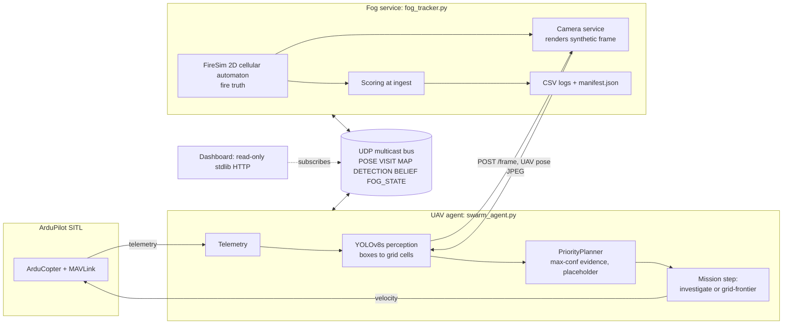

# PORTFOLIO_EVIDENCE.md — AI-Enabled Autonomous Wildfire Monitoring (ArduPilot UAV + YOLO)

Evidence export for writing a portfolio case study. Generated 2026-11-17 by read-only inspection of this repository
(branch `integration/yolo-perception-prep`, HEAD `8c1f6bd`, 116 commits, 2026-09-19 to 2026-11-13).
Nothing was run, trained or simulated for this document; every number below is quoted from a recorded repo artifact, with its path.
Where this document says "documented", the claim comes from a repo document; "verified" means I checked the file/code/config exists as described
(not that I re-ran the experiment). Tests were NOT re-run in this session (the suite takes about 5 minutes and renders images); test counts and pass
results are quoted from `docs/project-status.md`.

**Reading rule for the case-study writer:** this is a university research project (ECE 496, Fall 2026) whose own audits repeatedly _narrowed_ its claims.
The strongest honest story is rigorous methodology, auditable provenance and well-calibrated claims, not a headline performance number.
Do not write "synthetic beats real" or "AI improves autonomous firefighting/monitoring". The repo's evidence supports neither.

---

## 1. Project identity

| Item                     | Value                                                                                                                                                                                                                                                                                                                                                                                                               |
| ------------------------ | ------------------------------------------------------------------------------------------------------------------------------------------------------------------------------------------------------------------------------------------------------------------------------------------------------------------------------------------------------------------------------------------------------------------- |
| Name                     | AI-Enabled Autonomous Wildfire Monitoring (ECE 496, Fall 2026); repo `Ardupilot-UAV-YOLO`                                                                                                                                                                                                                                                                                                                           |
| One sentence             | A research system that trains YOLOv8s smoke detectors on synthetic versus real imagery, compares them across domains, and flies them in an ArduPilot SITL simulation to see how perception differences change a UAV's behaviour monitoring a simulated fire.                                                                                                                                                        |
| Repository               | `git@github.com:jabrogena5100/Ardupilot-UAV-YOLO.git` (origin; `docs/runpod/watchdog_security_review.md` states the repo is public, not independently verified). Several commits are **local and unpushed** (e.g. branch `science/boreal-v2` and tags `baseline-L1-3-v1`, `synth-v1` are local; `demo.py` exists only on `integration/yolo-perception-prep`, not `main`, per `docs/project-status.md`, 2026-11-13). |
| Project type             | Academic research + simulation/ML-infrastructure project (capstone). Not a production system; no real flights, no real users.                                                                                                                                                                                                                                                                                       |
| Status                   | Levels 1-3 complete and frozen as local tag `baseline-L1-3-v1` (pins in `docs/baseline/baseline_v1.json`). External validation run but "exploratory and provisional". Final report is "draft v1" (`docs/report/final_report.md`). Probability-map planner **not built** (`mapping/probability_map.py` is 0 lines, verified with `wc -l`). Multi-UAV is an architecture demo only.                                   |
| Intended users / problem | Intended audience is the course (professor, graders; `docs/PROFESSOR_GUIDE.md`, `QUICKSTART.md`). Problem: whether a smoke detector trained on auto-generated synthetic imagery behaves differently from one trained on real aerial imagery, and whether that difference propagates into autonomous UAV monitoring.                                                                                                 |

Repository size (verified by `find`/`wc`): about 18,500 lines of Python outside tests (eval 9.1k, synthgen 1.2k, dashboard 1.0k, fog 0.8k, sim 0.6k, mission 0.4k, comms 0.4k, perception 0.3k, planning 0.2k, mapping 0.15k, plus top-level scripts), tests 4.8k lines in 30 files with 390 `def test_` functions, 435 tracked files, a large docs tree. The line counts are my own `wc` measurements.

## 2. Portfolio-ready summary

**Project-card summary (about 55 words):**
A research platform that tests whether training a wildfire-smoke detector on synthetic or real imagery changes UAV behaviour. It includes a 2.5D synthetic image generator, a frozen cross-domain YOLOv8 evaluation harness (3 seeds per model family), and 56 ArduPilot SITL runs, with audits that corrected and narrowed the project's own claims.

**Case-study introduction (about 160 words):**
This capstone project asks a narrow question: does the training domain of a smoke detector, synthetic or real, change how well it perceives wildfire smoke, and does that difference carry into how an autonomous UAV monitors a fire? To answer it I built a 2.5D synthetic image generator that shares its pinhole-camera projection with the UAV simulation, trained three seeds each of a synthetic-trained and a real-trained YOLOv8s model, and evaluated all of them through one metric code path on frozen splits and on external datasets. I then wired the detectors into an ArduPilot SITL loop with a fog/ground-station service that owns the fire ground truth and scores every detection at ingest, and ran 56 paired 600-second simulations. The most instructive part was the verification discipline: independent audits found a leaky train/test split, a wall-clock fire-timing confound and over-stated statistics, and each finding was either fixed (clip-disjoint retraining) or documented and reflected in narrower claims.

## 3. Architecture

### 3.1 Stack

- Language: Python 3 (3.10.18 on the project VM; 3.12.3 on RunPod training pods). Dashboard front-end is vanilla HTML/CSS/JS (`dashboard/static/`), no build step.
- ML: Ultralytics YOLOv8s (8.4.173 for training), PyTorch 2.8.0+cu128 for training, CPU torch for local inference; NumPy/OpenCV/Pillow in the generator.
- Simulation: ArduPilot ArduCopter SITL (upstream repo `~/src/ardupilot`, reference only), MAVLink via pymavlink, custom 2D cellular-automaton fire model (`wildfire_sim.py`).
- Comms: UDP multicast "gossip" bus (`comms/gossip.py`), message schema `comms/schema.py`.
- Compute: RunPod GPU pods (RTX 4090) + network volume for training/eval; local 1-vCPU/2 GB Ubuntu VM for SITL and CPU inference.
- CI/automation: one GitHub Actions workflow (`.github/workflows/runpod-watchdog.yml`), stdlib-only Python.
- Tests: `unittest` (`python3 -m unittest discover -s tests -t .`). Requirements: `requirements-sim.txt`, `requirements-yolo.txt`.

### 3.2 Major components (verified to exist; file paths)

| Component                | Files                                                                                                                                                   | Role                                                                                                                                                                                                      |
| ------------------------ | ------------------------------------------------------------------------------------------------------------------------------------------------------- | --------------------------------------------------------------------------------------------------------------------------------------------------------------------------------------------------------- |
| Fog / ground station     | `fog_tracker.py`, `fog/state.py`, `fog/run_log.py`, `fog/config.py`                                                                                     | Owns fire truth (`FireSim`), scores each detection at ingest, writes `detections_<tag>.csv`, coverage CSVs, `manifest.json` (weights SHA-256, versions, git commit, oracle flag), `experiment_end_*.txt`. |
| UAV agent                | `swarm_agent.py`, `custom_vehicle.py`, `mission/grid_mission.py`, `mission/partitions.py`, `swarm_strategies.py`                                        | MAVLink control, grid-frontier coverage, reactive investigate-first behaviour, perception loop.                                                                                                           |
| Planner                  | `planning/priority.py` (188 lines incl. package)                                                                                                        | Placeholder: per-cell `max(confidence)` + repeat bonus, 20 s evidence lifetime, 60 s per-cell cooldown.                                                                                                   |
| Perception               | `perception/base.py`, `detector.py`, `frames.py`                                                                                                        | `YoloPerception` (SHA-256-verified weights, CPU Ultralytics, box to grid cell), HTTP frame client; `from_config()` fails soft to `NullPerception` unless `perception.strict`.                             |
| Camera / frame synthesis | `sim/camera.py`, `sim/frame_synth.py`, `sim/camera_service.py`                                                                                          | Shared pinhole projection; virtual nadir camera renders frames from fog's burning cells; truth never leaves fog.                                                                                          |
| Synthetic generator      | `synthgen/` (`render.py`, `scene_params.py`, `annotate.py`, `generate_dataset.py`, `configs/domain_rand.yaml`)                                          | 2.5D images: ground-plane texture + flat smoke billboards through the same pinhole code, auto-labels from alpha masks.                                                                                    |
| Eval harness             | `eval/metrics.py`, `eval/run_matrix.py`, `eval/datasets*.yaml`, `eval/validate_dataset.py`, `eval/level3_*.py`, `eval/external_*.py`                    | One `(checkpoint, test set) -> metrics` path for every matrix cell; Level 3 pairing/analysis/report tables.                                                                                               |
| RunPod orchestration     | `eval/runpod/` (`rp_common.py`, `launch_job.py`, `pod_supervisor.py`, `watchdog.py`)                                                                    | Budget gate, deadline-tagged pod names, stop-only watchdogs. Docs: `docs/runpod/orchestration.md`.                                                                                                        |
| Dashboards               | `dashboard/server.py` (live, read-only, port 8080), `dashboard/replay_server.py` (replay of 56 recorded runs, port 8081), `dashboard/static/multi.html` | stdlib `http.server`, canvas drawing, polls `/api/state` every 250 ms.                                                                                                                                    |
| Demos                    | `demo.py` (replay), `demo_multi.py` (4-UAV live), `run_fresh.py` (fresh single run)                                                                     | See section 4/9.                                                                                                                                                                                          |

### 3.3 Data flow

Intended: `UAV camera -> neural network -> detection probability -> geographic probability map -> priority region -> coverage decision` (CLAUDE.md). **Implemented** except the probability map. As flown in the final Level 3 runs (documented in `docs/experiments/perception_integration_v0.md` and `level3_final.md` section 1): UAV pose -> HTTP POST `/frame` to fog -> fog renders a synthetic JPEG from its burning cells -> YOLO (CPU) -> pixel boxes -> `Camera.unproject_ground` -> grid cell -> DETECTION message on the UDP bus -> `Fog.ingest_detection` scores it against truth (true if any BURNING cell within Chebyshev distance 1) -> `PriorityPlanner` -> INVESTIGATE target or coverage step -> MAVLink velocity commands.

### 3.4 Background processing, deployment, integrations

- Background: SITL instances, fog, agents run as separate processes (tmux-managed by `launch_sitl_swarm.py`); the Level 3 queue (`eval/level3_queue.py`) ran 2 parallel slots for part of the campaign. GPU training ran as supervised RunPod jobs.
- Deployment: no cloud deployment of the _product_; everything is local simulation. Cloud is used only for GPU training/eval (RunPod) and the GitHub Actions cost watchdog. No AWS.
- External integrations: ArduPilot SITL, MAVLink, RunPod REST API, GitHub Actions, public datasets (Boreal Forest Fire, FireMan-UAV-RGBT, FASDD_UAV; used as data, with licences recorded in `docs/external_eval/`).

### 3.5 Mermaid diagram (consistent with `docs/report/figures/architecture_corrected.png`, which I viewed)

## 4. Implemented functionality

| Capability                                 | Where                                                                                                                         | How it works                                                                                                                                                        | Verification                                                                                                                                                                                                                                                                                                                                     | Status                                                                                                  |
| ------------------------------------------ | ----------------------------------------------------------------------------------------------------------------------------- | ------------------------------------------------------------------------------------------------------------------------------------------------------------------- | ------------------------------------------------------------------------------------------------------------------------------------------------------------------------------------------------------------------------------------------------------------------------------------------------------------------------------------------------ | ------------------------------------------------------------------------------------------------------- |
| 2.5D synthetic smoke generator             | `synthgen/`, `sim/camera.py`                                                                                                  | Seeded scene sampling; ground texture and smoke billboards projected via the one shared pinhole model; labels from alpha mask. Smoke is flat (no volume/occlusion). | `tests/test_camera.py`, `tests/test_synthgen.py` (41 tests passing 2026-10-27, about 124 s, per project-status); dataset record `docs/datasets/synth_smoke_v1.md` (5,304 images, per-file hashes, 10,616 files verified); visual contact sheets `docs/synthetic/poc_v*_contact_sheet.jpg`.                                                       | Complete (frozen `synth_smoke_v1`, tag `synth-v1`). Known mismatch: box edge-touch 0.76 vs Boreal 0.30. |
| Dataset validation (unified YOLO format)   | `eval/validate_dataset.py`                                                                                                    | One validator for both domains, single class `0: smoke`.                                                                                                            | Used for POC and full dataset (`docs/synthetic/poc_report.md`).                                                                                                                                                                                                                                                                                  | Complete.                                                                                               |
| Unified evaluation harness                 | `eval/metrics.py`, `eval/run_matrix.py`, `eval/datasets.yaml`                                                                 | Numpy metrics, same code path for every (model, test set) cell; saved predictions allow offline recompute.                                                          | `tests/test_eval_metrics.py`, `test_run_matrix.py`; reproduced Model B's Ultralytics test numbers (0.9442/0.6688 vs harness 0.9511/0.6730, project-status); offline recompute of 30 cells on a different machine: detection metrics identical (`docs/experiments/boreal_v2/results/recompute_check.json`, quoted in `boreal_v2_results.md` 5.5). | Complete.                                                                                               |
| YOLOv8s training (Model A/B, 3 seeds each) | `eval/runpod/`, `models/MODELS.md`, `docs/experiments/*/training/`                                                            | COCO-pretrained YOLOv8s, 100 epochs, imgsz 640, batch 32, AdamW lr0 0.002, deterministic.                                                                           | Hash-pinned checkpoints (`models/MODELS.md`), per-run configs/`results.csv` in git. Checkpoints not in git.                                                                                                                                                                                                                                      | Complete. Full-run bit reproducibility not demonstrated.                                                |
| Clip-disjoint Boreal v2 split              | `eval/boreal_v2_split.py`, `docs/experiments/boreal_v2.md`, `boreal_v2_audit.md`                                              | Built after an audit found v1 not video-disjoint; all Model B retrained.                                                                                            | `tests/test_boreal_v2*.py`; file-list hashes re-verified per run (`INTEGRITY.json`).                                                                                                                                                                                                                                                             | Complete; residual same-site leakage risk documented.                                                   |
| Level 2 cross-domain 2x2                   | `docs/experiments/level2_v2.md`, `boreal_v2_results.md`                                                                       | 6 models x 5 datasets through one harness; seed SD and clip-clustered bootstrap reported separately.                                                                | See section 7.                                                                                                                                                                                                                                                                                                                                   | Complete.                                                                                               |
| Fire ground-truth simulation               | `wildfire_sim.py`, `fog_tracker.py`                                                                                           | 2D cellular automaton; fog owns it (agents must not import FireSim).                                                                                                | Tests for fog scoring/planner (`tests/test_planner.py`, `test_perception_integration.py`: truth isolation checks).                                                                                                                                                                                                                               | Complete; fire stepped on wall clock (confound, below).                                                 |
| Single-UAV SITL mission + perception loop  | `swarm_agent.py`, `mission/`, `perception/`, `sim/camera_service.py`                                                          | See 3.3.                                                                                                                                                            | 56 + 2 recorded runs with `run_meta.json`; one-run demo `docs/experiments/perception_single_demo_2026-11-02/`.                                                                                                                                                                                                                                   | Complete (single UAV).                                                                                  |
| Level 3 paired experiment                  | `eval/level3_pairs.py`, `level3_queue.py`, `level3_analyze.py`, `level3_report_tables.py`; `docs/experiments/level3_final.md` | 8 held-out scenarios x 7 arms, T=600 s, oracle off; plan generator refuses configs differing in more than 5 perception keys.                                        | Analysis reproduced byte-for-byte from raw runs (project-status 2026-11-13); calculation tests with hand-computed answers.                                                                                                                                                                                                                       | Complete but descriptive only; see section 7.                                                           |
| Reactive planner                           | `planning/priority.py`                                                                                                        | Detection above threshold -> per-cell evidence; fly to best cell before coverage.                                                                                   | `tests/test_planner.py`.                                                                                                                                                                                                                                                                                                                         | Complete as a **placeholder**; not a probabilistic planner.                                             |
| Probability map (log-odds)                 | `mapping/probability_map.py`                                                                                                  | Empty file.                                                                                                                                                         | `wc -l` = 0.                                                                                                                                                                                                                                                                                                                                     | **Planned, not built.**                                                                                 |
| External validation (FireMan, FASDD)       | `eval/external_*.py`, `docs/external_eval/`                                                                                   | Six frozen checkpoints run as eval-only on external sets; pooled vs cluster-macro AP separated.                                                                     | Reports regenerated from saved predictions; `tests/test_external_*.py`.                                                                                                                                                                                                                                                                          | Experimental / provisional (protocol not frozen; owner review G2/G3 pending).                           |
| Replay dashboard of 56 runs                | `dashboard/replay_server.py`, `docs/demo/level3_final_replay.html` (2.6 MB single file)                                       | Replays saved files, compare view, layer toggles, "UAV's view (hide truth)".                                                                                        | `tests/test_replay_final.py` (counts agree with `per_run.csv` for 56 runs); clean-clone `python3 -I demo.py` served snapshot (project-status 2026-11-13). Real-browser rendering not tested.                                                                                                                                                     | Complete (presentation tool, not live).                                                                 |
| Four-UAV live architecture demo            | `demo_multi.py`, `dashboard/static/multi.*`                                                                                   | 4 SITL instances, quadrant partitions, grid_frontier, no perception.                                                                                                | Documented run: sysids 1-4 in tlog, 600 s mission exit 0, no leftovers, coverage 77% (illustrative only). `tests/test_demo_multi.py`.                                                                                                                                                                                                            | Demonstration only; no multi-UAV validation.                                                            |
| RunPod orchestration + watchdog            | `eval/runpod/`, `.github/workflows/runpod-watchdog.yml`                                                                       | See section 9.                                                                                                                                                      | 49 mock tests; read-only live API checks.                                                                                                                                                                                                                                                                                                        | Partial: documented as not declared ready (see section 9).                                              |
| Reproducibility baseline freeze            | `eval/freeze_baseline.py`, `docs/baseline/baseline_v1.json`                                                                   | Pins code commit, 9 checkpoint hashes, 15 configs, 56 run configs, 209 result artifacts, 290 raw files.                                                             | `python3 eval/freeze_baseline.py --verify` reported only 3 amended doc files (documented in `docs/baseline/AMENDMENTS.md`).                                                                                                                                                                                                                      | Complete (local tag, unpushed).                                                                         |

## 5. Three hardest engineering challenges

### Challenge 1 — Making the synthetic-vs-real comparison trustworthy (split leakage, audits, retraining)

- **Problem:** the 2x2 cross-domain matrix is the deliverable; if one cell is inflated, everything downstream is wrong.
- **Constraints:** Boreal's pre-existing split came from a read-only source; only 31 source clips; GPU budget $100 autonomous / $20 per experiment; frozen test sets must never be tuned.
- **Solution:** one harness path for all cells; frozen, hash-pinned splits; an independent (Codex) audit found that the Boreal v1 split was not video-disjoint (3 clips shared train/test, 2 train/val, via 197 background `Empty-Images` train frames; `docs/experiments/level2_v2_audit.md`). Response: built a clip-disjoint v2 split (31 normalised clips; train 3,462 / val 748 / test 744 frames) and retrained all three Model B seeds, preserving v1 results untouched. Withdrew an over-stated "seed variability dominates sampling uncertainty" claim.
- **Tradeoffs:** v1 and v2 numbers are not comparable; v2 test has only 8 clips so clustered intervals are very wide; the v2 retraining used `cache=ram` (documented speed-only deviation after two slow RunPod hosts decoded 4K frames about 6x slower), checked for pixel identity on 24/24 probe images.
- **Evidence:** v1 sensitivity analysis showed no consistent inflation of Real->Real; v2 numbers in section 7; offline recompute identical for detection metrics; `INTEGRITY.json` re-hashing of all pinned checkpoints before/after.
- **Remaining limitations:** same-site, same-session relationships remain (22 train/test frame pairs within 4 dHash bits, sensitivity <= 0.001 mAP50); 3 seeds; synthetic test scenes share 6 texture slots.

### Challenge 2 — A closed perception-to-flight loop where the ground truth cannot leak to the agent

- **Problem:** get YOLO detections into an ArduPilot SITL control loop on a 1-vCPU/2 GB VM, score them against a changing fire truth, and not let the agent see truth.
- **Constraints:** truth changes over time (so scoring must happen at ingest); one process must not simulate the fire twice ("fog owns the fire"); CPU-only inference (about 300 ms/frame, rendering about 500 ms); UAV boot (about 75 s) vs fire start; the generator's projection must be the same code as the UAV camera's.
- **Solution:** fog-side camera service returns only JPEGs (no endpoint exposes fire state); agent sends only its own pose; `sim/frame_synth.py` subclasses the frozen renderer; `Fog.ingest_detection` scores each detection; tests forbid direct FireSim import in agent-side perception modules; `level3_pairs.py` starts fog only after agents report READY and refuses config sets that differ in anything but five perception keys; manifest records weights SHA-256, versions and `oracle_hazards` (false in all 58 manifests).
- **Tradeoffs:** a nadir camera is outside the synthetic training pitch range (28-89 deg, mostly oblique), so Level 2 does not measure what Level 3 sees (documented finding); plume geometry is a simulation parameter with no empirical basis; a transitive import chain `sim/camera.py -> fog.state -> wildfire_sim` remains (documented, not fixed).
- **Evidence:** single-UAV demo (102 frames, 51 detections, 46 true / 5 false, first true detection 24 s after ignition; `perception_integration_v0.md` section 3; explicitly "not comparable to anything"); 58 clean runs (exit 0, no leftover processes).
- **Remaining limitations:** simulated frames, not real imagery; cell-level (about 160 m) scoring; single UAV.

### Challenge 3 — Auditing the SITL experiment: finding and bounding confounds rather than hiding them

- **Problem:** 56 SITL runs could easily be over-interpreted.
- **Constraints:** one 1-vCPU VM; about 12 minutes per run; 600 s window; only 4 distinct ignition cells.
- **Solution (successive audits, all documented in `level3_final.md`):** (a) unit of inference changed from 8 scenarios to 4 ignition cells, so the smallest possible exact two-sided sign-flip p is 0.125 and nothing is claimed significant; (b) a **fire-clock confound** found: `fog_tracker.py` (lines 311-314) steps the fire on wall-clock time, so in 2-slot parallel execution the realized fire differs between arms (ignition-time ratio vs baseline 1.003-1.004 sequential, mean 1.05-1.06 and up to 1.09 parallel; burned sets differ in scenarios 2014 and 2005); (c) censoring: 15/56 ignition-cell visits unobserved by 600 s, so capped times are lower bounds and some capped differences are not bounds; (d) 9 post-600 s detection records removed from one run; (e) provenance: 26 runs on clean commit `0c2f6c6`, 32 on a dirty infrastructure-only state, one repeat on an unrecoverable intermediate harness.
- **Tradeoffs:** no rerun was authorized, so confounds are documented, not fixed; conclusions reduced to direction-of-effect statements.
- **Evidence:** `docs/experiments/level3_final.md` sections 2-9, `cluster_stats.md`, `fire_clock.md`, `censoring.md`, `provenance.csv` under `docs/experiments/level3_final/`; analysis regenerated byte-identically from raw runs (project-status 2026-11-13); calculation tests with hand-computed answers (`tests/test_level3_analyze.py`, `test_level3_report_calcs.py`).
- **Remaining limitations:** the experiment cannot separate a training-domain effect from the Level 2 domain gap (Model A in-domain on synthetic frames, Model B cross-domain; thresholds differ per arm); suggested fix (run-clock fire stepping or sequential execution) is not done.

## 6. Testing and verification

| Evidence                                                                                                                                                                      | Type                       | Source                                                                               | Run status                                                                                                                          |
| ----------------------------------------------------------------------------------------------------------------------------------------------------------------------------- | -------------------------- | ------------------------------------------------------------------------------------ | ----------------------------------------------------------------------------------------------------------------------------------- |
| 390 test functions in 30 files under `tests/` (my `grep -c "def test_"`)                                                                                                      | Automated unit/integration | `tests/`                                                                             | Counted, not run today.                                                                                                             |
| "385 tests pass (291 s)" on 2026-11-13; earlier "299 tests pass" (2026-11-09)                                                                                                 | Full-suite result          | `docs/project-status.md`                                                             | Documented; I did not re-run.                                                                                                       |
| Clean-clone replay: `python3 -I demo.py` serves the snapshot, Ctrl+C exits 0 with no leftover process                                                                         | Manual end-to-end          | `docs/project-status.md` 2026-11-13                                                  | Documented as run.                                                                                                                  |
| Fresh baseline run via `run_fresh.py` (scenario 2001): exit 0, 705 s, config SHA-256 and end values (`visited_frac` 0.22, `burnt_cnt` 3, 0 detections) equal the recorded run | End-to-end SITL            | project-status 2026-11-13                                                            | Documented as run.                                                                                                                  |
| Fresh Model A seed-0 run differed from the recorded one (first true detection 106 s vs 101 s; true/false records 17/4 vs 14/2; coverage 0.17 vs 0.21)                         | Reproducibility check      | project-status 2026-11-13                                                            | Documented: **fresh runs are not bit-reproducible**.                                                                                |
| Analysis scripts rerun from the 56 raw runs reproduced `per_run.csv` and tables byte-for-byte, figures pixel-for-pixel                                                        | Reproduction               | project-status 2026-11-13                                                            | Documented as run.                                                                                                                  |
| Offline recompute of 30 Level 2 cells on a different machine (detection metrics identical; 107 localisation stats differ <= 4.2e-6 relative; NumPy 2.1.2 vs 2.5.3)            | Reproduction               | `boreal_v2_results.md` 5.5                                                           | Documented as run.                                                                                                                  |
| Harness reproduces Model B test mAP50/mAP50-95 within tolerance (0.9511/0.6730 vs Ultralytics 0.9442/0.6688)                                                                  | Validation                 | project-status Level 2                                                               | Documented.                                                                                                                         |
| 4-UAV demo: sysids 1-4 observed in tlog, 600 s mission fog exit 0, coverage 77%                                                                                               | Integration                | project-status 2026-11-13                                                            | Documented as run (headless browser only).                                                                                          |
| Baseline freeze `--verify`                                                                                                                                                    | Provenance check           | `docs/baseline/baseline_v1.json`, `AMENDMENTS.md`                                    | Documented; 3 amended doc files reported.                                                                                           |
| CPU perception benchmark (6 checkpoints x 16 frames)                                                                                                                          | Benchmark                  | `docs/experiments/perception_bench_2026-11-02.jsonl`, `perception_integration_v0.md` | Raw jsonl in repo (verified).                                                                                                       |
| Watchdog: 49 mock tests, live read-only API checks, workflow run #1 succeeded on manual dispatch                                                                              | CI/ops                     | `docs/runpod/orchestration.md`, `watchdog_security_review.md`                        | Documented; scheduled cron run "not yet observed" at the time of writing; later status unknown.                                     |
| Not tested (per project docs)                                                                                                                                                 | Gaps                       | `docs/PROFESSOR_HANDOUT.md`, project-status                                          | Real-browser rendering, clean-machine ArduPilot install, VirtualBox forwarding, full 56-run rerun, training, Level 2 re-evaluation. |

Observability: per-run `manifest.json`, `run_meta.json`, `detections_<tag>.csv`, `coverage_t_*.csv`, `fire_cells_*.csv`, `experiment_end_*.txt`, tlogs; RunPod `events.jsonl`/`DONE.json`; `runpod-logs` branch. Raw run data (2.8 GB) is in gitignored `local_data/level3/final/` and is **not** available in the repo checkout.

Reproduction instructions (documented): `README.md`, `QUICKSTART.md`, `docs/PROFESSOR_GUIDE.md`; `python3 check_setup.py`; `python3 demo.py` then http://localhost:8081 (replay); `python3 demo_multi.py --drones 4` then http://localhost:8080/multi.html; `python3 run_fresh.py --arm baseline|A|B|all`; `python3 eval/freeze_baseline.py --verify`; `python3 eval/level3_analyze.py ... && python3 eval/level3_report_tables.py`; `python3 eval/report_figures.py`. A fresh clone does **not** contain weights, datasets, raw runs or ArduPilot.

## 7. Measured results

General: Model A = `synth_smoke_best_v1*.pt` (synthetic-trained YOLOv8s, seeds 0-2, dataset `synth_smoke_v1`). Model B = in current Level 2 v2/Level 3/external work, `real_boreal_v2_best_seed{0,1,2}.pt` (clip-disjoint Boreal v2). The earlier `real_boreal_best_v1.pt` (seed 0, v1 split) is a different, historical model; **v1 and v2 numbers are not comparable**. mAP uses IoU 0.5 (mAP50) unless noted; operating point conf 0.25. Sample SD is across n=3 seeds (itself very uncertain). Training hardware: RunPod secure 1x RTX 4090, US-IL-1, ultralytics 8.4.173, torch 2.8.0+cu128. These are detection metrics (Levels 1/2), not UAV mission performance.

### 7.1 Level 2 matrix, Boreal v2 (source `docs/experiments/boreal_v2_results.md` section 1, dated 2026-10-29)

Boreal column = `boreal_v2_test` (744 frames, 8 clips); synthetic column = `synth_test_pos` (701 images, 6 texture slots).

| Cell         | mAP50 mean (SD) | mAP50 per seed      | mAP50-95 mean | Recall@0.25 | Precision@0.25 | FP/img@0.25 |
| ------------ | --------------- | ------------------- | ------------- | ----------- | -------------- | ----------- |
| Synth->Synth | 0.995 (0.000)   | 0.995, 0.995, 0.995 | 0.986         | 1.000       | 1.000          | 0.000       |
| Synth->Real  | 0.512 (0.095)   | 0.602, 0.522, 0.413 | 0.238         | 0.530       | 0.612          | 0.319       |
| Real->Synth  | 0.612 (0.104)   | 0.587, 0.522, 0.726 | 0.289         | 0.496       | 0.869          | 0.072       |
| Real->Real   | 0.899 (0.027)   | 0.923, 0.903, 0.870 | 0.531         | 0.899       | 0.869          | 0.129       |

Interpretation/limits: the same-domain real cell is far above cross-domain cells; Synth->Synth is saturated (cannot discriminate). Clip-clustered bootstrap (8 clips, 1000 resamples, test-set sampling only): Real->Real seed 0 0.923 [0.838, 0.966]; Synth->Real seed 0 0.602 [0.175, 0.810]; so the _size_ of the gap is not tightly estimated, though every seed shows the same ordering. Real empty-frame false positives (65 held-out frames from 2 clips): Model A 0.138-0.262 of frames fire, Model B-v2 0.015; Model A on 350 synthetic empties: 0.000. Edge-touching boxes: Model A recall 0.892/0.703/0.689 vs 0.482/0.463/0.456 elsewhere (candidate explanation, untested).

### 7.2 Model B v1 (historical; `models/MODELS.md`, `docs/experiments/real_boreal_v1.md`)

Test (701 frames, v1 split, conf 0.001, IoU 0.7 Ultralytics): P 0.937, R 0.933, mAP50 0.944, mAP50-95 0.669; trained once 2026-10-04, 100 epochs, wall time 2,268 s (about 22 s/epoch). v1 split is not video-disjoint (see challenge 1). Level 2 v2 (v1 split, 3 seeds): Real->Real mAP50 0.954 +- 0.003; Synth->Real 0.375 +- 0.059 (`docs/experiments/level2_v2.md` via project-status).

### 7.3 Training cost/time (documented)

Model A: about 996-1,000 s per run (100 epochs, 4090). Model B v2: 1,020-1,021 s for seeds 1-2 on a fast host; 4,983 s for seed 0 on a busier host (host speed varied up to about 6x). Boreal v2 experiment estimated GPU spend $2.93 (4 attempts + 7 diagnostic pods, estimated from pod start/stop times x $0.89/h); billing read 2026-11-02: $12.35 total project spend, about $87.6 of the $100 autonomous allowance remaining (`docs/project-status.md` ledger). These are estimates/billing reads, not itemised invoices; the ledger itself notes some October pods are individually unexplained and billing lags by hours. No spend after 2026-11-02 is recorded.

### 7.4 Level 3 (56 SITL runs; `docs/experiments/level3_final.md` section 4, 2026-11-09)

Setup: ArduPilot SITL, single UAV, 10x10 grid (about 160 m cells), 600 s window, oracle off, 8 held-out scenarios on **4 ignition cells** x 7 arms (no-detector baseline; A seeds 0-2; B-v2 seeds 0-2). Per-arm thresholds A 0.30-0.45, B 0.01-0.02 (chosen on separate calibration scenarios). Family value = mean over 3 seeds; +- is SD across seeds. Times are **capped means** (unobserved = 600 s; lower bounds). Host: 1-vCPU VM; 26 runs sequential/clean commit, 30 + 2 repeats parallel/dirty infrastructure state.

| Metric                                                     | Baseline    | Model A        | Model B-v2     |
| ---------------------------------------------------------- | ----------- | -------------- | -------------- |
| First true detection, s (capped mean)                      | no detector | 177.1 +- 7.0   | 296.6 +- 48.0  |
| First visit of ignition cell, s (capped; 15/56 censored)   | 221.4       | 268.0 +- 31.1  | 487.7 +- 14.4  |
| Grid coverage at 600 s                                     | 0.209       | 0.183 +- 0.003 | 0.147 +- 0.007 |
| False detection observations/run (repeated, not incidents) | 0           | 0.3 +- 0.2     | 55.7 +- 23.0   |
| Distinct false cells/run                                   | 0           | 0.2 +- 0.2     | 6.4 +- 1.2     |

Censoring: ignition-cell visit not observed in 0/8 baseline, 1/24 A, 14/24 B runs. Direction: A earlier than B on first true detection and ignition-cell visit in 4/4 cells and 8/8 scenarios; coverage higher and false observations lower in 4/4 cells. **Neither perception arm reached the ignition cell sooner than the plain patrol on average** (A earlier in only 2 of 8 scenarios, both parallel-mode); both covered less than the patrol.
Limits: no significance claim possible (smallest two-sided p = 0.125 with 4 clusters); Model A in-domain vs Model B cross-domain, so this restates the Level 2 gap; fire-clock confound; radius-one truth; reactive planner not a probabilistic one; simulated smoke frames; single UAV. Repeats (n=1 each, confounded with execution mode): +13-14 s later; not a jitter estimate.

### 7.5 External validation (exploratory, protocol not frozen/preregistered; `docs/external_eval/*`, `docs/report/final_report.md` section 7)

Six frozen checkpoints, eval-only, CPU, conf 0.25 / IoU 0.5, pooled mAP50 mean over seeds:

| Dataset                                                     | Model A          | Model B-v2       | Notes                                                               |
| ----------------------------------------------------------- | ---------------- | ---------------- | ------------------------------------------------------------------- |
| FireMan primary (5 videos, one 2023-08-26 burn, 750 frames) | 0.462 (SD 0.173) | 0.683 (SD 0.177) | one burn event, about 23 effective frames, loose/interpolated boxes |
| FASDD smoke-positive pooled (2,149 images)                  | 0.408            | 0.224            | driven by a 720p group of unknown platform (descriptive only)       |
| FASDD UAV-nadir (306)                                       | 0.437            | 0.423            | pooled means differ by -0.014; equivalence not tested               |
| FASDD tower (718)                                           | 0.011            | 0.003            | uninformative                                                       |

Defensible reading (the report's own): the A-vs-B ranking _varies across datasets_; no universal ranking. Owner-only reviews (annotation G2, overlap G3) are still open, so status stays provisional.

### 7.6 Compute/resource measurements (`perception_integration_v0.md`, 2026-11-02)

On the 1-vCPU AMD Ryzen AI 5 340 VM (1,968 MB RAM): YOLO about 298-312 ms median per frame, rendering about 497-521 ms, peak RSS about 735-740 MB, 16 frames per model (8 fire, 8 empty). These are CPU wall-clock medians on a tiny sample; wiring checks, not scientific results. The documented estimate that 4 UAVs need about 4 GB/3-4 vCPU is marked `[INFERRED]` there.

## 8. Screenshots and visual evidence

No browser screenshots of the dashboard exist in the repo (I found none; do not fabricate). Existing images:

| Path                                                                                           | Shows                                                                             | Useful because                           | Public?                                                         | Sensitive data?                                      |
| ---------------------------------------------------------------------------------------------- | --------------------------------------------------------------------------------- | ---------------------------------------- | --------------------------------------------------------------- | ---------------------------------------------------- |
| `docs/report/figures/architecture_corrected.png` (+ `.svg`)                                    | System architecture: SITL, UAV agent, fog service, UDP bus (viewed; matches code) | Best architecture diagram                | Yes                                                             | None seen. **Untracked in git** (not yet committed). |
| `docs/report/figures/synthetic_pipeline_corrected.png` (+ `.svg`)                              | Synthetic data pipeline (not opened by me; named by file)                         | Explains generator                       | Needs review                                                    | Untracked; verify content before use.                |
| `docs/report/figures/training_evaluation_corrected.png` (+ `.svg`)                             | Training/evaluation pipeline (not opened)                                         | Explains harness                         | Needs review                                                    | Untracked; verify.                                   |
| `docs/report/figures/fig1_level2_matrix.png`                                                   | Bar chart: mean of 3 seeds + seed dots, synthetic vs Boreal v2 test (viewed)      | Clear, honest Level 2 headline           | Yes                                                             | None                                                 |
| `docs/report/figures/fig2_ranking_across_datasets.png`                                         | A vs B ranking across datasets                                                    | Shows the ranking varies                 | Yes (not opened; matches report text)                           | None expected                                        |
| `docs/experiments/level3_final/fig_level3_scenarios.png`                                       | Per-run markers by scenario/arm, censoring drawn at cap                           | Honest Level 3 view                      | Yes                                                             | None expected (not opened)                           |
| `docs/experiments/level3_final/fig_trajectories.png`                                           | HUD-cell trajectories, 6 sequential runs; "illustrative only"                     | Qualitative behaviour                    | Yes, with its caveat                                            | None expected                                        |
| `docs/synthetic/poc_v1_contact_sheet.jpg`, `poc_v2_contact_sheet.jpg`                          | Contact sheets of synthetic images                                                | Shows what the generator produces        | Yes (synthetic)                                                 | None                                                 |
| `docs/experiments/perception_single_demo_2026-11-02/empty_nadir_frame_lake_false_positive.jpg` | Synthetic empty frame with lake false-positive boxes                              | Concrete failure mode                    | Yes                                                             | None                                                 |
| `docs/demo/level3_final_replay.html` (2.6 MB)                                                  | Self-contained replay snapshot of 56 runs                                         | Live-able demo; could be hosted/embedded | Needs review (confirm no absolute local paths/hostnames inside) | Not inspected                                        |

Recommended to copy: `architecture_corrected.png`, `fig1_level2_matrix.png`, `fig2_ranking_across_datasets.png`, `fig_level3_scenarios.png`, `poc_v2_contact_sheet.jpg`, `empty_nadir_frame_lake_false_positive.jpg`; optionally the replay HTML. Recommend also taking real screenshots of the replay (port 8081) and 4-UAV page (port 8080) yourself; none exist. Real Boreal/FireMan/FASDD imagery is licensed (CC BY / CC BY-SA, per `docs/external_eval/` and report references) and should not be redistributed in the portfolio without attribution/licence check.

## 9. Deployment and operational evidence

- **Local development architecture (verified/documented):** Ubuntu VM (1 vCPU, 1.9 GB RAM; 4 vCPU for the 4-UAV demo), ArduPilot SITL, fog, agents and dashboards as local processes; tmux-managed. `--speedup` can be < 1.
- **Cloud actually used:** RunPod GPU pods for training/eval (RTX 4090 at $0.89/h, US-IL-1) and a 50 GB network volume `wildfire-datasets` (about $0.10-0.12/day). Verified from ledger in `docs/project-status.md`. A CPU pod generated the synthetic dataset (2 vCPU, `docs/datasets/synth_smoke_v1.md`). No AWS, no deployed web service.
- **Cost controls (implemented in code, `docs/runpod/orchestration.md`):** budget gate before any create (worst case = price x (boot 600 s + timeout + latency) + $0.25 must be <= $20 and cumulative <= $100); deadline-tagged pod names `<run>__dl<epoch>`; three stop layers (in-pod supervisor, in-pod watchdog, off-pod GitHub Actions watchdog every 5 min); code has **no delete path** for pods or volumes; append-only logs (`events.jsonl`, `DONE.json`, branch `runpod-logs`).
- **Security-related implementation:** watchdog workflow security review (`docs/runpod/watchdog_security_review.md`): schedule + `workflow_dispatch` only (no PR triggers), secret exposed to one step, `persist-credentials: false`, no `${{ }}` in `run:` bodies, stdlib-only code; dashboard is read-only (`rx_only`, cannot transmit); weights SHA-256 verified before load; oracle mode off by default with a loud banner; checkpoints/datasets/secrets gitignored. The review is explicitly "not an independent audit".
- **Operational status caveat:** orchestration docs state "implemented and tested with mocks, a local HTTP server and read-only live API calls. No paid pod has been created via this workflow. Not declared ready"; the watchdog was "not yet armed" at that writing (2026-10-29). Whether it was later armed is **not recorded** in what I read. Later paid runs (e.g. Boreal v2 attempt 1 needed a manual stop because the pod "could not self-stop (REST 403)") show orchestration did not fully work as designed.
- **Teardown/cleanup:** pods stopped (not deleted) by design; Level 3 runner cleans only processes it started (tagged); `Ctrl+C` on `demo_multi.py` stops everything in about 6 s (documented). Stale pods remain on the RunPod account per the ledger (7 stopped probe/diagnostic + 4 attempt pods, "removable by hand"); volume storage continues to accrue.
- **Backups:** checkpoints backed up locally under `local_data/backups/` with SHA256SUMS (re-verified 2026-11-11).
- **Operational limitations:** fresh SITL runs are not bit-reproducible; fire stepped on wall clock; single-VM scale; unpushed commits/tags; repo checkout lacks weights, data and raw runs.

## 10. Lessons and next steps

- **Architectural tradeoffs:** 2.5D generator (cheap, controllable, shares projection with the simulator) vs flat-billboard smoke with no volume/occlusion; a fog-owned ground truth (clean scoring, no leakage) vs a wall-clock fire loop (timing confound); stdlib dashboard (no dependencies) vs no maps/WebSockets; reactive placeholder planner (simple, flown) vs the intended log-odds map (never built).
- **Known weaknesses (all documented in repo):** edge-touch 0.76 vs 0.30; 3 seeds; 8 test clips; 4 ignition cells; right-censored times; in-domain-vs-cross-domain confound in Level 3; exploratory external evaluation; no probability map; no multi-UAV validation; simulated imagery in the SITL loop; some provenance not recoverable (one repeat's harness, full training replay).
- **Future work the repo itself lists:** build and calibrate the log-odds map from Level 2 sensitivity/specificity; rerun Level 3 with matched execution mode and run-clock fire stepping; synthetic v2 matching edge-touch; owner annotation review; more seeds; source-level independent grouping for FASDD.
- **What I would change if rebuilding (my suggestions, not claims from the repo):** step the fire from the run clock from the start; freeze the external protocol before any inference; define the clip-disjoint split and a bigger test set before the first training run; pre-register scenario count with an adequate number of distinct ignition cells; ship a CI job running the fast tests; commit and push the figures/tags earlier.
- **What the project demonstrates (supported by evidence):** end-to-end ML-in-simulation systems integration (SITL, MAVLink, YOLO, UDP bus); experiment design and hash-pinned provenance; willingness to find and publicly correct one's own errors; cost-aware cloud GPU orchestration; test discipline (390 test functions, including analysis-code tests with hand-computed answers); technical writing. It does **not** demonstrate production deployment, real-flight performance or a validated planner.

## 11. Candidate professional services (supported by evidence; none claimed as paid work)

1. **ML evaluation-harness and experiment-audit engagement:** build a single-code-path evaluation harness, frozen splits, leakage audits and statistics reporting for a CV model (evidence: `eval/`, `level2_v2_audit.md`, `boreal_v2.md`, seed/cluster reporting).
2. **Simulation-in-the-loop integration for drones/robotics:** connect a vision model to ArduPilot SITL or another simulator with truth isolation, logging and run manifests (evidence: `swarm_agent.py`, `sim/camera_service.py`, `perception_integration_v0.md`, 58 clean runs).
3. **GPU cost-control and reproducibility tooling for ML teams:** budget gates, deadline-tagged pods, stop-only watchdogs, hash-pinned artifact registries (evidence: `eval/runpod/`, `.github/workflows/runpod-watchdog.yml`, `models/MODELS.md`, `docs/baseline/`). Caveat: the orchestration's own docs say it was not declared ready; present it as a design with partial verification.

## 12. Evidence source index

| Claim                                       | Supporting file                                                                                        | Locator                                             | Confidence                                                  | Public?                      |
| ------------------------------------------- | ------------------------------------------------------------------------------------------------------ | --------------------------------------------------- | ----------------------------------------------------------- | ---------------------------- |
| Research question and three-level structure | `CLAUDE.md`; `README.md`                                                                               | "Three-level research structure"; opening paragraph | verified                                                    | yes                          |
| Probability map not built                   | `mapping/probability_map.py`; `README.md`                                                              | file is 0 lines; "Honest scope"                     | verified                                                    | yes                          |
| Level 2 v2 matrix numbers                   | `docs/experiments/boreal_v2_results.md`                                                                | section 1 tables                                    | documented                                                  | yes                          |
| Boreal v1 split leakage found               | `docs/experiments/level2_v2_audit.md`                                                                  | section 1                                           | documented                                                  | yes                          |
| Model B v1 numbers                          | `models/MODELS.md`; `docs/experiments/real_boreal_v1.md`                                               | Results                                             | documented                                                  | yes                          |
| Checkpoint hashes/provenance                | `models/MODELS.md`                                                                                     | tables                                              | documented (hashes not recomputed; checkpoints not in repo) | needs review (private paths) |
| `synth_smoke_v1` composition 5,304 images   | `docs/datasets/synth_smoke_v1.md`                                                                      | Split counts                                        | documented                                                  | yes                          |
| 2.5D generator shares projection with sim   | `docs/synthetic/poc_report.md`; `sim/camera.py`; `synthgen/render.py`                                  | "What was built"                                    | verified (files exist), documented (claim)                  | yes                          |
| Level 3 headline table                      | `docs/experiments/level3_final.md`                                                                     | section 4                                           | documented                                                  | yes                          |
| Fire-clock confound                         | `docs/experiments/level3_final.md`; `fog_tracker.py`                                                   | section 2a; lines 311-314                           | documented (code line not re-inspected)                     | yes                          |
| 15/56 censored visits                       | `docs/experiments/level3_final.md`                                                                     | section 6                                           | documented                                                  | yes                          |
| Smallest p = 0.125 with 4 clusters          | `docs/experiments/level3_final.md`                                                                     | section 3                                           | documented                                                  | yes                          |
| Single-UAV demo 51 detections / 46 true     | `docs/experiments/perception_integration_v0.md`                                                        | section 3                                           | documented                                                  | yes                          |
| CPU benchmark                               | `docs/experiments/perception_bench_2026-11-02.jsonl`; `perception_integration_v0.md`                   | section 2                                           | documented                                                  | yes                          |
| External validation numbers                 | `docs/report/final_report.md`; `docs/external_eval/*_report.md`                                        | section 7                                           | documented                                                  | yes (with caveats)           |
| 385 tests pass                              | `docs/project-status.md`                                                                               | 2026-11-13 entry                                    | documented (not re-run)                                     | yes                          |
| 390 test functions                          | `tests/*.py`                                                                                           | `grep -c "def test_"`                               | verified                                                    | yes                          |
| Four-UAV demo works                         | `docs/project-status.md`; `demo_multi.py`; `tests/test_demo_multi.py`                                  | 2026-11-13 entry                                    | documented                                                  | yes (demo, not result)       |
| Replay of 56 runs                           | `docs/demo.md`; `dashboard/replay_server.py`; `docs/demo/level3_final_replay.html`                     | file exists (2.6 MB)                                | verified (existence), documented (behaviour)                | needs review                 |
| RunPod watchdog design/security             | `docs/runpod/orchestration.md`; `watchdog_security_review.md`; `.github/workflows/runpod-watchdog.yml` | whole docs; workflow header                         | verified (workflow read), documented (behaviour)            | yes (review for key/pod IDs) |
| Armed/working watchdog in production        | `docs/runpod/watchdog_security_review.md`                                                              | "Status"                                            | unverified (docs say not armed at the time)                 | no                           |
| Spend ledger                                | `docs/project-status.md`                                                                               | "Autonomous RunPod budget ledger"                   | documented; some pods unexplained                           | needs review                 |
| Baseline freeze                             | `docs/baseline/baseline_v1.json`, `AMENDMENTS.md`                                                      | file list                                           | documented                                                  | yes                          |
| Architecture figure                         | `docs/report/figures/architecture_corrected.png`                                                       | viewed                                              | verified                                                    | yes                          |
| Level 3 conclusion about training domain    | `docs/experiments/level3_final.md`                                                                     | "Reading rule"                                      | documented                                                  | yes (use narrow wording)     |

## 13. Open questions for the project owner

1. Is the repository public, and are the local-only branches/tags (`science/boreal-v2`, `baseline-L1-3-v1`, `synth-v1`) going to be pushed? The portfolio link and "reproducible" claim depend on it. Answer: They're not going to be pushed.  
2. Were the RunPod watchdog's cron runs ever observed and the lifecycle test run? If so, where is the record (docs stop at "not armed")? Answer: It never worked to begin with. 
3. Did the final report (draft v1) get a final version, grade or professor/external review outcome that can be cited? Also whether the Codex-audit process may be described publicly as an "independent audit" (it is an AI reviewer per `AGENTS.md`/docs). Answer: The final report is done. 
4. Which role did you personally play versus AI assistants (the repo shows heavy Claude/Codex involvement)? The case study should state this honestly. Answer: I picked out the dataset (borreal dataset), examined its limitations hence why we had to do splitting and tested it on synthetic and external evaulations. 
5. Are you free to publish the course project (ECE 496) and the replay HTML publicly, and are there any institutional/sponsor restrictions? Dataset licences (CC BY / CC BY-SA) require attribution. Answer: No, too much work. The documents / research aspect is enough. 
6. Are the three untracked `*_corrected` figures final? I only viewed `architecture_corrected.png`. Answer: Ignore this.
7. Can you provide real screenshots of the replay and four-UAV pages? None exist in the repo. Answer: No, I still think the research / documents are enough. 

