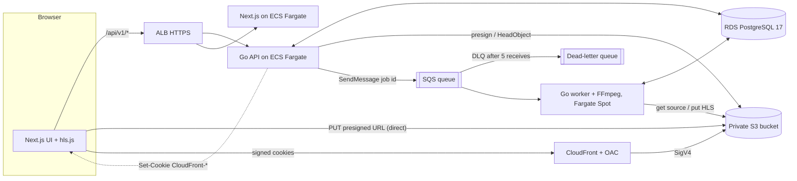

# RyuCloud: Portfolio Evidence Handoff

Generated 2026-11-17 from a read-only inspection of the repository at HEAD `f14c846` (branch `main`, clean tree). Nothing was executed except read-only `git`, `grep`, `wc` and file reads. **No test, build, AWS or Terraform command was run while producing this document.** Every "passed" below is a result recorded in the repository docs (`docs/verification.md`, `docs/deployment-log.md`, `docs/troubleshooting.md`) by the owner or by earlier Claude Code sessions; the confidence column in section 12 says how well each is backed.

Terminology used throughout (matches `docs/verification.md`):

- **Run**: executed and its output seen by the person who recorded it.
- **Reported / user-reported**: stated by the owner; raw output is not stored in the repo.
- **Documented**: described in a doc or comment only.
- **Not run**: no evidence.

---

## 1. Project identity

| Field                                              | Value                                                                                                                                                                                                                                   |
| -------------------------------------------------- | --------------------------------------------------------------------------------------------------------------------------------------------------------------------------------------------------------------------------------------- |
| Name                                               | RyuCloud                                                                                                                                                                                                                                |
| One sentence                                       | A cloud-native, YouTube-style video platform in which browsers upload directly to object storage and a separate Go worker transcodes uploads to adaptive-bitrate HLS with FFmpeg.                                                       |
| Repository                                         | `git@github.com:jabrogena5100/RyuCloud.git` (the GitHub repo is described as **public** in `docs/verification.md`; browse URL is presumably `https://github.com/jabrogena5100/RyuCloud`, not confirmed from the repo beyond the remote) |
| Project type                                       | Solo full-stack and cloud/DevOps portfolio project (web app, async media pipeline, Terraform-defined AWS infrastructure). Not a commercial product, no real users.                                                                      |
| Git history                                        | 25 commits, 2026-11-03 to 2026-11-14 (`git log`). First four commits are scaffolding noise ("test first commit", "initial commit (2)").                                                                                                 |
| Size (approx., tracked files, `wc -l`)             | backend 12,623 lines (Go incl. tests, SQL, OpenAPI); frontend/src 3,513; infra/terraform 2,361; scripts 937; 171 tracked files; 15 docs files                                                                                           |
| Code metrics (counted by grep, not by test runner) | 232 Go `func Test*`; 79 `it(`/`test(` calls in frontend (the docs report 106 Vitest tests, presumably from parametrized cases); 88 Terraform `resource` blocks (some use `for_each`)                                                    |

### Implementation status (precise)

`docs/project-status.md` (last updated 2026-11-14) defines four levels:

| Level            | Status per repo                       | Notes                                                                                                                                                |
| ---------------- | ------------------------------------- | ---------------------------------------------------------------------------------------------------------------------------------------------------- |
| Locally complete | **Yes**                               | Accounts, channels, direct uploads, queue, HLS worker, retries, crash recovery, readiness, Next.js UI, Compose stack. Local suite re-run 2026-11-10. |
| Cloud-ready      | Mostly                                | Terraform fmt/validate passed offline.                                                                                                               |
| Cloud-verified   | **Yes, for one session (2026-11-14)** | Applied, migrated, served, uploaded, processed, played back, then **destroyed**.                                                                     |
| Production-ready | **No**                                | Restore test, alarm drill, cost data not done.                                                                                                       |

**The AWS stack is not running now.** It was destroyed on 2026-11-14 (94 resources). Only the Terraform state bucket, domain registration and Route 53 zones remain. A live demo link does not exist. The owner's stated plan (`docs/temporary-deployment.md`, memory notes) is sessions-only AWS use until job applications start.

**Documentation staleness warning for the portfolio writer:** `README.md` (status line: "Phase 4 ... prepared but not deployed ... Nothing has been applied"), `infra/README.md` ("Written but never applied"), `docs/aws-architecture.md` ("defined but not deployed") and the README roadmap row 3 ("end-to-end verification result is not recorded") predate the 2026-11-14 deployment and are **outdated**. `docs/verification.md`, `docs/deployment-log.md` and `docs/project-status.md` are the current sources. Also `docs/uploads.md`'s sequence diagram still shows `complete` setting the video to `processing`; the state-machine table in the same file and the code path say `queued`.

### Intended users and problem

Per `README.md` and `docs/architecture.md`: the user-facing scenario is a creator who signs up, creates a channel, uploads a video and shares it; viewers watch via HLS. The engineering problem the project is built to explore is keeping large video bytes out of the API path (direct-to-storage uploads, async processing, CDN delivery) while keeping job state correct under crashes, duplicates and retries. There are no real users, and the repo states "No performance or scalability measurements have been made."

---

## 2. Portfolio-ready summaries

### Short project card (about 55 words)

> RyuCloud is a YouTube-style video platform built to explore cloud-native design. Browsers upload straight to private object storage; a Go worker transcodes to HLS with FFmpeg, with PostgreSQL leases for crash recovery. Next.js frontend, Terraform-defined AWS stack (ECS, RDS, S3, CloudFront signed cookies), deployed once end to end, then torn down.

(Word count approx. 54.)

### Full case-study introduction (about 160 words)

> RyuCloud is a portfolio project that builds the core of a video-sharing platform and then deliberately pushes it through a real cloud deployment. A Next.js frontend talks to a Go modular-monolith API backed by PostgreSQL. Uploads never pass through the API: it issues a presigned URL, the browser sends the file straight to private object storage, and the API verifies the stored object before queuing a processing job. A separate Go worker claims jobs with database leases, runs FFprobe and FFmpeg to produce 360p/720p HLS renditions and a thumbnail, and survives crashes, duplicate messages and retries. Locally everything runs on Docker Compose with MinIO and Redis. The same code was applied to AWS using Terraform (VPC, ALB, ECS Fargate, RDS, S3, SQS, CloudFront with signed cookies) for one verified session on 2026-11-14, which found and fixed a real signed-cookie bug before the stack was destroyed to control cost. It is not production-ready, and no performance benchmarks exist.

(Word count approx. 160.)

---

## 3. Architecture

### Technology stack (versions from `go.mod`, `package.json`, README, docs)

| Layer          | Technology                                                                                                                                                                          | Evidence                                                 |
| -------------- | ----------------------------------------------------------------------------------------------------------------------------------------------------------------------------------- | -------------------------------------------------------- |
| Frontend       | Next.js 15 (`^15.5.7`, App Router), React 19, TypeScript, Tailwind CSS 4, hls.js 1.5; Vitest 3 + Testing Library                                                                    | `frontend/package.json`                                  |
| API            | Go (`go 1.25.0` minimum; built with Go 1.26.10 image), standard-library `net/http` routing (Go 1.22+ patterns), `log/slog` JSON logs                                                | `backend/go.mod`, `backend/Dockerfile`, `README.md`      |
| Database       | PostgreSQL 17 (`postgres:17-alpine` locally, RDS PostgreSQL 17 on AWS), `pgx/v5` 5.9.2, hand-written SQL (no ORM), `goose/v3` 3.24.3 migrations embedded in the binary              | `go.mod`, `docs/architecture.md`                         |
| Auth           | Argon2id (19 MiB, 2 passes, 1 lane), server-side sessions (SHA-256 token hash stored, HttpOnly SameSite=Lax cookie), Origin-check CSRF defence-in-depth, per-email login throttling | `docs/architecture.md`, `backend/internal/auth/`         |
| Object storage | MinIO fork "Silo" (`pgsty/minio`, pinned by tag and digest) locally; AWS S3 on AWS; AWS SDK for Go v2 behind an `ObjectStorage` interface                                           | `docker-compose.yml`, `docs/uploads.md`                  |
| Queue          | Redis 7 lists locally; SQS standard queue + DLQ on AWS; `Queue` interface                                                                                                           | `integrations/redisqueue.go`, `sqsqueue.go`              |
| Worker         | Second Go binary (`backend/cmd/worker`) sharing internal packages; `ffprobe`/`ffmpeg` invoked via `exec.Command` with argument lists                                                | `docs/processing.md`                                     |
| Media delivery | Local: API streams from storage. AWS: CloudFront with Origin Access Control to private S3, signed cookies (HLS) and signed URLs (thumbnails)                                        | `integrations/cloudfront.go`, `docs/aws-architecture.md` |
| IaC            | Terraform 1.10.5 (pinned, run via Docker wrapper), AWS provider 6.72.0                                                                                                              | `infra/terraform/`, `scripts/aws-terraform.sh`           |
| CI/CD          | GitHub Actions: CI (Go, frontend, Terraform fmt/validate, shellcheck, image builds) and a manual, approval-gated, OIDC-based deploy workflow                                        | `.github/workflows/ci.yml`, `deploy.yml`                 |
| Local env      | Docker Compose (`db`, `minio`, `minio-init`, `redis`, `worker`, `backend`, `frontend`), ports bound to `127.0.0.1`                                                                  | `docker-compose.yml`                                     |

### Major components

- **Next.js frontend**: pages `/`, `/login`, `/register`, `/upload`, `/studio`, `/watch/[id]`; same-origin `/api/v1/*` rewrite so session cookies are first-party; polling (3 s) for status; `VideoPlayer` uses native HLS on Safari or hls.js elsewhere.
- **Go API (modular monolith)**: packages `auth`, `channels`, `videos`, `uploads`, `jobs`, `transcode`, `worker`, `health`, `integrations`, `httpx`, `database`, `config`, `server`. One hand-maintained OpenAPI file (`internal/server/openapi.yaml`) served with Swagger UI at `/api/v1/docs`.
- **Go worker**: queue consumer, lease/heartbeat, sweeper, retries with jittered exponential backoff, graceful shutdown.
- **PostgreSQL**: tables `users`, `auth_sessions`, `channels`, `videos`, `video_uploads`, `processing_jobs`, `video_renditions` (3 goose migrations: initial schema, video uploads, video processing). Source of truth for job state.
- **Object store**: private bucket; keys `uploads/{videoID}/{uploadID}/source` and `videos/{videoID}/hls/...`, `videos/{videoID}/thumbnail.jpg`.

### Data flow

1. `POST /uploads`: API validates (auth, channel ownership, type allow-list, size cap, per-user pending limit under an advisory lock), writes `videos(uploading)` + `video_uploads(pending)` in one transaction, returns a presigned PUT with size and content type signed into the URL.
2. Browser PUTs bytes directly to MinIO/S3 (no cookies, signature is the credential).
3. `POST /uploads/{id}/complete`: API does `HeadObject`, compares size and type with what was declared, then in one transaction sets upload `uploaded`, video `queued`, and inserts `processing_jobs` (`ON CONFLICT (video_id) DO NOTHING`). It then publishes the job ID to the queue on a best-effort basis (the row is already durable).
4. Worker: receive ID, claim with lease in PostgreSQL, download source, ffprobe/validate, ffmpeg per rendition (360p/720p, never upscaled), thumbnail, upload segments then media playlists then master playlist last, then one transaction (job `succeeded`, video `ready`, rendition rows), then acknowledge the queue message.
5. Playback: local, API streams whitelisted HLS paths after visibility checks. AWS, `GET /videos/{id}` returns a `playback_url` and sets three `CloudFront-*` cookies scoped to `/videos/{id}/`; hls.js fetches from the media host.

### Background processing

Described in section 5 (challenge 1). Key parameters (defaults from `docs/processing.md`): lease 120 s, heartbeat every third of the lease, sweeper every 15 s, max attempts 4, backoff 30 s base doubling to a 15 min cap with ±20 % jitter, job timeout 30 min, max source duration 120 min, concurrency 1, FFmpeg threads 2, graceful shutdown grace 60 s.

### Deployment architecture (as defined in Terraform, as applied on 2026-11-14)

Route 53 → ALB (HTTPS, ACM, `/api/*` → api, else → web) → ECS Fargate services `api`, `frontend`, `worker` (worker on Fargate Spot) in **public subnets, no NAT**; RDS PostgreSQL 17 `db.t4g.micro` single-AZ in isolated subnets; private S3 bucket; CloudFront (`media.<domain>`, ACM in us-east-1, OAC, trusted key group); SQS + DLQ; Secrets Manager; ECR (immutable tags, scan on push); CloudWatch alarms/dashboard/log metric filters; SNS email; budget; optional GitHub OIDC deploy role. Region `us-west-2`.

### External integrations

AWS (S3, SQS, CloudFront, ECS, RDS, ECR, Route 53, ACM, Secrets Manager, CloudWatch, SNS, Budgets, IAM/OIDC); GitHub Actions; FFmpeg/ffprobe; Redis; MinIO fork. No payment, email-sending or third-party auth integrations.

### Mermaid diagram (derived from `docs/aws-architecture.md` and `docs/architecture.md`)

Local equivalent: Redis replaces SQS, MinIO replaces S3, API replaces CloudFront for media (`PLAYBACK_BACKEND=api`).

---

## 4. Implemented functionality

Status key: **complete** = implemented and verified at the level stated; **partial**; **planned**.

| Capability                                                          | Where                                                                    | How it works                                                                                                                                                                              | Verification                                                                                                                                                                         | Status                                                                                        |
| ------------------------------------------------------------------- | ------------------------------------------------------------------------ | ----------------------------------------------------------------------------------------------------------------------------------------------------------------------------------------- | ------------------------------------------------------------------------------------------------------------------------------------------------------------------------------------ | --------------------------------------------------------------------------------------------- |
| Registration, login, logout, `/auth/me`                             | `backend/internal/auth/` (`handlers.go`, `service.go`, `password.go`)    | Argon2id; unknown-email logins still do a dummy hash; random 256-bit token, only SHA-256 stored; HttpOnly SameSite=Lax cookie                                                             | `auth_test.go`, `internal/server/auth_test.go`, `scripts/smoke-test.sh` ("Smoke test passed", re-run 2026-11-10)                                                                     | Complete (no email verification, no password reset; registration discloses `409 email_taken`) |
| Login throttling                                                    | `auth/loginlimit.go`                                                     | 10 failures / 15 min per normalized e-mail, 429 + `Retry-After`, refused before hashing, in-memory, bounded to 50,000 keys                                                                | 5 limiter unit tests plus `TestRepeatedFailedLoginsAreThrottled` (documented PASS)                                                                                                   | Complete for one API process; not shared across tasks                                         |
| Origin/CSRF check, request IDs, JSON error envelope, panic recovery | `internal/httpx/`                                                        | Rejects state-changing requests from untrusted Origin or `Sec-Fetch-Site: cross-site`; one error shape with `request_id`                                                                  | `httpx_test.go`; covered in `go test ./...`                                                                                                                                          | Complete                                                                                      |
| Channels                                                            | `internal/channels/`                                                     | Unique immutable handle, owner-only update                                                                                                                                                | `server/channels_test.go`                                                                                                                                                            | Complete                                                                                      |
| Video metadata, visibility rules, feeds                             | `internal/videos/`                                                       | Owner sees all; others only `ready` + `public`/`unlisted`; invisible videos return 404 (no ID leak)                                                                                       | `server/videos_test.go`                                                                                                                                                              | Complete                                                                                      |
| Direct-to-storage uploads                                           | `internal/uploads/`, `integrations/s3.go`, `frontend/src/lib/upload*.ts` | Presigned PUT with signed size/type; `complete` re-verifies with HeadObject; conditional `UPDATE ... WHERE status='pending'` makes complete/cancel races safe; lazy expiry with 2 h grace | `server/uploads_test.go`; `scripts/e2e-upload-test.sh` 23 checks (Run 2026-11-10); real-MinIO tests `S3_INTEGRATION_TEST=1` 3 PASS (2026-11-10); in AWS, upload worked on 2026-11-14 | Complete (single-part only, max 1 GiB default, no resume)                                     |
| Async HLS processing                                                | `internal/worker/`, `internal/jobs/store.go`, `internal/transcode/`      | See challenge 1 and `docs/processing.md`                                                                                                                                                  | 35-check E2E (Run 2026-11-10 and 2026-11-05); 43-check crash E2E; FFmpeg tests 11.9 s; in-process failure-path tests in `server/worker_test.go` (about 33 test functions)            | Complete locally; verified once on AWS with HEVC test clips                                   |
| Job queue adapters                                                  | `integrations/redisqueue.go`, `sqsqueue.go`, `queue.go`, `memory.go`     | `Queue` interface with Receive/Ack/Requeue                                                                                                                                                | `redisqueue_test.go`, `sqsqueue_test.go`; Redis used in all local E2E; SQS used on AWS 2026-11-14 (worker logs `job succeeded`)                                                      | Complete                                                                                      |
| Playback, local                                                     | `videos/media.go`                                                        | API streams whitelisted file names, API chooses Content-Type, `nosniff`                                                                                                                   | `TestHLSPlaybackIsServedFromPrivateStorageWithAuthorization`, `TestHLSEndpointOnlyServesWhitelistedPathsOfReadyVideos`; manual browser steps in README                               | Complete (dev only: media goes through API)                                                   |
| Playback, CloudFront                                                | `integrations/cloudfront.go`, `playback.go`                              | Stdlib RSA-SHA1 signer; per-video cookie policy `https://media.<domain>/videos/{id}/*`, 2 h TTL; per-thumbnail signed URLs, 1 h                                                           | 8 unit tests incl. `TestGrantPlaybackPolicyKeepsLiteralWildcard`; live check 2026-11-14 (playlist 200, segment 200 of 582,800 bytes, no-cookie 403)                                  | Complete for hls.js path; Safari native, cookie expiry **not verified**                       |
| Studio dashboard and watch page                                     | `frontend/src/app/studio`, `watch/[id]`, `VideoPlayer.tsx`               | Polling while uploading/queued/processing; failure reasons displayed                                                                                                                      | 14 test files, 106 tests (Run 2026-11-10, 3 consecutive runs after a flaky-test fix)                                                                                                 | Complete; search box is a placeholder; no comments, subscriptions, view counting              |
| Health/readiness                                                    | `internal/health/`                                                       | `/health` liveness; `/health/ready` checks DB and that applied migration >= embedded newest                                                                                               | `health_test.go`; live: `0.4.0`, `schema_version 3` locally and on AWS                                                                                                               | Complete                                                                                      |
| Migrations                                                          | `internal/database/migrations/00001-00003`                               | goose, embedded; integration tests run up, fully down, up again each run                                                                                                                  | Part of `go test ./...`; `TestMigrationBackfillsPhase2VideosWithoutLosingData`                                                                                                       | Complete                                                                                      |
| Terraform AWS stack                                                 | `infra/terraform/*.tf` (13+ files)                                       | See section 9                                                                                                                                                                             | fmt/validate Run; real `plan` (115 to add) and apply Run on 2026-11-14 (owner output)                                                                                                | Complete and exercised once; destroyed                                                        |
| CI                                                                  | `.github/workflows/ci.yml`                                               | 5 jobs: backend (gofmt, vet, build, test against Postgres 17), frontend (ci, typecheck, test, build), Terraform fmt/validate, shellcheck, image builds (no push)                          | `actionlint` 1.7.7 clean (Run 2026-11-10); CI success on commit `9eff787` noted via `gh api` on 2026-11-13; 7 required checks in branch ruleset                                      | Complete                                                                                      |
| Manual deploy workflow                                              | `.github/workflows/deploy.yml`                                           | `workflow_dispatch` + typed confirmation, `main` only, `production` environment, OIDC role, ECR push, one-off migration task, service roll-out                                            | `actionlint` only                                                                                                                                                                    | **Written, never run** ("Deploy workflow run once end to end: Not done")                      |
| Security hardening                                                  | see section 9                                                            | `govulncheck` 0 reachable, `gitleaks` clean, etc.                                                                                                                                         | Run 2026-11-10                                                                                                                                                                       | Complete as stated                                                                            |
| Restore from backup, WAF, autoscaling, Multi-AZ, NAT                | n/a                                                                      | n/a                                                                                                                                                                                       | n/a                                                                                                                                                                                  | **Planned / not implemented**                                                                 |
| Multipart/resumable upload, DRM, fMP4, subtitles                    | n/a                                                                      | n/a                                                                                                                                                                                       | n/a                                                                                                                                                                                  | **Planned or out of scope** (`docs/uploads.md`, `docs/processing.md` limitations)             |

---

## 5. Three hardest engineering challenges

### Challenge 1: Making a background transcoding pipeline correct under crashes, duplicates and retries

**Initial problem.** A single upload must produce exactly one playable video even if the API cannot reach the queue, a message is delivered twice, a worker is `SIGKILL`ed mid-encode, the database blips as a job finishes, or two workers race for the same job.

**Constraints.** Redis (local) and SQS (AWS) both give at-least-once delivery and are not durable stores of truth; encodes take seconds to many minutes; workers on Fargate Spot can be interrupted; PostgreSQL is the only strongly consistent store available; no extra coordination service (no Temporal etc.).

**Solution implemented** (`backend/internal/jobs/store.go`, `backend/internal/worker/worker.go`, `docs/processing.md`):

- The queue carries only a job ID. PostgreSQL `processing_jobs` is the source of truth, with CHECK constraints (a `processing` job always has an owner and lease; `attempts <= max_attempts`).
- **Claim** is one conditional `UPDATE` (state `queued`/`retry` and due, or `processing` with expired lease, and attempts left). With N concurrent workers exactly one matches; the rest drop the message.
- **Lease + heartbeat**: every mutation (progress, succeed, retry, fail, release) requires `locked_by = me AND state='processing'`; otherwise `ErrLeaseLost` and the worker abandons its work.
- **Sweeper** in every worker uses `FOR UPDATE SKIP LOCKED` to re-send jobs with no live owner (lost publishes, elapsed backoff, expired leases) and fails jobs whose worker died on the final attempt.
- **Ack only after commit**: the result transaction (job succeeded, video ready, rendition rows) commits first; the message is acknowledged afterwards.
- **Idempotent outputs**: keys depend only on the video ID; leftovers under `videos/{id}/` are deleted before upload; the master playlist is uploaded last.
- Permanent failures (corrupt input, no video track, too long) fail immediately; transient ones retry with jittered exponential backoff. Graceful shutdown releases jobs back to `queued` without consuming an attempt.

**Tradeoffs.** Crash-recovery latency is bounded by the lease (up to about 2 minutes), not instant. No resume: a retry restarts the encode. A stale SQS in-flight copy reappears after its visibility timeout as a harmless duplicate. Progress resets visibly on retry.

**Evidence it works.**

- `internal/server/worker_test.go` has about 33 tests against real PostgreSQL with in-memory storage/queue and a fake FFmpeg, including `TestOnlyOneOfManyConcurrentClaimsWins`, `TestConcurrentWorkersProcessAJobExactlyOnce`, `TestCrashedWorkersJobIsRecoveredAfterItsLeaseExpires`, `TestWorkerThatDiesOnTheLastAttemptFailsTheJob`, `TestWorkerAbandonsWorkWhenItsLeaseIsStolen`, `TestMessageIsNotAcknowledgedUntilTheResultIsPersisted`, `TestCompleteSucceedsEvenIfTheQueueIsDownAndASweepRecovers`, `TestRetryExhaustionFailsTheVideo`, `TestGracefulShutdown...`. These are Run results per `docs/verification.md` (all 9 Go test packages `ok`, 2026-11-10); I did not re-run them.
- Real-stack crash test: `CRASH_TEST=1 bash scripts/e2e-processing-test.sh` printed "passed (43 checks)" (35 baseline plus 8 recovery checks); worker was killed at about 2 % progress, lease expired, second attempt completed with `attempts=2` (`docs/troubleshooting.md` §10, dated 2026-11-05; re-run 2026-11-10 per `verification.md`).

**Remaining limitations.** No load or concurrency measurements; Redis delivery path never tested under Redis failure on the real stack (only in-process tests); SQS Spot-interruption behavior is reasoned in `docs/aws-audit.md` ("checked and found sound by reading"), not drilled; failure drills on AWS "Not done".

### Challenge 2: Private video delivery through CloudFront signed cookies (and the bug a unit test could not see)

**Initial problem.** Keep the S3 bucket fully private and serve HLS through a CDN only to viewers the API has authorized, without proxying video bytes through the API.

**Constraints.** An HLS master playlist references renditions and segments by relative path, so a query-string signature on the playlist URL is not inherited by the relative requests. CloudFront signatures are defined as RSA-SHA1 (protocol constraint). Cookies cannot span `*.cloudfront.net`, so a domain you control is required. The project wanted no new dependency to pin.

**Solution implemented** (`backend/internal/integrations/cloudfront.go`, `playback.go`, `infra/terraform/cloudfront.tf`, `s3.tf`): the API checks normal visibility rules, then sets three `CloudFront-*` cookies (`Secure`, `HttpOnly`, `Domain=<app host>`, `Path=/videos/{id}/`) signing a policy for `https://media.<domain>/videos/{id}/*` for 2 hours; thumbnails use per-image signed URLs (1 h). The signer is about 100 lines of standard-library code (PKCS#1/PKCS#8 key parsing, 2048-bit minimum, base64 variant `+ = /` to `- _ ~`). The distribution uses Origin Access Control and a trusted key group; the bucket policy admits only that distribution for `videos/*`.

**The bug (documented in `docs/verification.md`, "Cloud end-to-end test").** On the first cloud test, the upload and processing worked (worker logged `job succeeded`, 2 renditions; S3 held playlists, segments, thumbnail; API reported `ready`), but playback failed: CloudFront returned 403 `AccessDenied` for playlist and segment while the signed thumbnail returned 200. Decoding the cookie policy (values not printed) showed the Resource was `.../videos/<id>/%2A`: `GrantPlayback` built it with `url.URL.String()`, which percent-encoded the wildcard, and CloudFront matches the literal text. The unit test only signed a hand-written resource, so it never exercised the real path. Fix (commit `0dda14b`): build the resource as `"https://" + domain + "/" + VideoPrefix + "*"`, plus new test `TestGrantPlaybackPolicyKeepsLiteralWildcard`. Only the API image was rebuilt and rolled.

**Tradeoffs.** Cookies cannot be revoked before the 2 h expiry (a stolen cookie jar can replay within the TTL); no silent refresh (paused viewers must reload after 2 h); needs a registered domain; RSA-SHA1 is mandated by CloudFront; maintaining ~100 lines of signer rather than using an SDK helper.

**Evidence it works.** After the fix (read-only checks by the recording session using the public video's cookies, on 2026-11-14): policy resource `https://media.ryucloud.link/videos/<id>/*`; `master.m3u8` 200 `application/vnd.apple.mpegurl`; `720p/index.m3u8` 200; a segment 200 (582,800 bytes); the same playlist without cookies 403; unsigned media 403 on both CloudFront and S3 directly. Browser playback after the fix was **reported by the owner** ("videos play"); no screenshot or recording exists in the repo.

**Remaining limitations.** The `Go` tests for the fix were not run by the recording session (no Go on host); "result not reported" per `verification.md`. Cookie-expiry behavior and Safari native HLS with cross-origin credentials are untested. The `alb-5xx` early alarm cause is inferred only.

### Challenge 3: Deploying and tearing down the AWS stack within short-lived credentials and a cost budget

**Initial problem.** Apply a 115-resource Terraform stack to a real account using keyless short-lived credentials (`aws login`, IAM user with MFA, no access keys), run it only in temporary sessions to avoid roughly $90-117/month of always-on cost, and prove it tears down completely.

**Constraints.** `scripts/aws-terraform.sh` exports credentials once into a Terraform-1.10.5 Docker container; they last about 15 minutes. RDS creation and ACM certificate validation can exceed that. DNS delegation, CloudFront deletion (10-20 min) and an account that is an Organization management account added uncertainty. Budget goals were far below the always-on estimate ($50/month even with zero tasks).

**Solution and recovery actually performed (2026-11-14, from `docs/verification.md`).**

- Plan reviewed: `115 to add, 0 to change, 0 to destroy`; checked for `db.t4g.micro`, `multi_az = false`, no NAT/WAF.
- Delegation bug found and fixed first: domain registration had auto-created a second hosted zone and the `.link` registry pointed to it, so certificates could never validate; an earlier "delegation verified" claim was wrong (local resolver differed from the registry). Fixed with `route53domains update-domain-nameservers`.
- First apply failed twice with `ExpiredToken` mid-run; Terraform wrote `errored.tfstate` and left a lock. Recovery: read lock ID from the `.tflock` object, `terraform force-unlock`, `terraform state push errored.tfstate`, `terraform untaint aws_db_instance.main` (the database was `available`; replacing it would have deleted a working DB), then staged applies. Final: `22 added, 1 changed, 0 destroyed`.
- A mount-`~/.aws` credential approach was tried and **rejected** (S3 backend found no credentials in the container); reverted.
- Design choices supporting teardown: `protect_data = false` makes RDS skip the final snapshot, S3 and ECR `force_destroy`, secrets recovery window 0; `deploy_services = false` lets the first apply create services with zero tasks.
- Staged destroy completed: `Apply complete! Resources: 0 added, 0 changed, 94 destroyed.`
- `scripts/aws-audit.sh` direct checks (ECS, ALBs, NAT, EIPs, EBS, VPCs, RDS, S3, SQS, ECR, secrets, CloudFront, ACM, CloudWatch, IAM, OIDC) all printed `ok ... none`.

**Tradeoffs.** Public-subnet tasks with no NAT (saves about $33/month per AZ, costs public IPv4 charges and weaker network isolation); single-AZ RDS; no snapshot-restore path in temporary mode; the lesson that any single apply/destroy must finish inside about 15 minutes of fixed credentials (apply in stages) is **"Not yet written into the runbook"** per the repo.

**Evidence.** `docs/verification.md` Phase 5 table and "First apply: what went wrong"; `docs/deployment-log.md` row 2026-11-14. All of these are owner-pasted outputs reviewed by a Claude Code session, not raw logs stored in the repo.

**Remaining limitations.** The audit script's tag-search section listed 19 stale entries and ended with `RESULT: items listed above remain`; each was checked directly and found `NotFound`/`INACTIVE` or empty, so it is treated as a stale index and a script flaw (not yet fixed). 115 resources were planned, 94 were destroyed; the repo does not reconcile the difference (some planned resources may not have been counted the same way, or the staged apply counts differ; see open questions). Next-day cost was **not checked**; **no measured cost exists**. Hours up were not recorded. The deploy workflow was never run end to end. Account-level budgets were not created.

---

## 6. Testing and verification

### 6.1 Automated test inventory (counted from source, not executed)

| Suite                                                                                                           | Count                                                                                                                           | Where                                                                                                                       | Needs                              |
| --------------------------------------------------------------------------------------------------------------- | ------------------------------------------------------------------------------------------------------------------------------- | --------------------------------------------------------------------------------------------------------------------------- | ---------------------------------- |
| Go unit + API/DB integration                                                                                    | 232 `func Test*` across 9 packages                                                                                              | `backend/internal/**/_test.go`; DB tests use `<POSTGRES_DB>_test` (or `TEST_DATABASE_URL`), migrations up, down, up per run | PostgreSQL                         |
| Go FFmpeg tests (real ffprobe/transcode/thumbnail/cancel with generated synthetic video)                        | `internal/transcode/ffmpeg_integration_test.go`, `transcode_test.go`                                                            | worker image with ffmpeg                                                                                                    | FFmpeg                             |
| Go MinIO S3 tests (opt-in, `S3_INTEGRATION_TEST=1`): presigned round trip, tampered upload rejected, URL expiry | `integrations/s3_integration_test.go`                                                                                           | MinIO                                                                                                                       |                                    |
| Frontend Vitest                                                                                                 | 14 files; 79 `it()` calls found by grep; docs state 106 tests                                                                   | `frontend/src/**/*.test.ts(x)`                                                                                              | Node 22 container                  |
| End-to-end shell scripts                                                                                        | `scripts/smoke-test.sh`, `e2e-upload-test.sh`, `e2e-processing-test.sh` (with `CRASH_TEST=1`)                                   | scripts                                                                                                                     | running Compose stack, migrated DB |
| Static checks                                                                                                   | `gofmt`, `go vet`, `tsc --noEmit`, `terraform fmt/validate`, `actionlint`, `shellcheck`, `gitleaks`, `govulncheck`, `npm audit` | CI and `scripts/validate-terraform.sh`                                                                                      |                                    |

### 6.2 Results recorded in the repo (what was actually run)

Source for all rows: `docs/verification.md` unless stated. Environment for the 2026-11-10 re-verification: Ubuntu VM, Docker 29.9.3, Compose 5.7.0, Node 22.22.1; Go ran in containers.

| Claim                                                                                                                                                                    | Status                       | Value                                                                                                                                                                                           | Source / date                                            |
| ------------------------------------------------------------------------------------------------------------------------------------------------------------------------ | ---------------------------- | ----------------------------------------------------------------------------------------------------------------------------------------------------------------------------------------------- | -------------------------------------------------------- |
| `go build`, `gofmt -l`, `go vet` clean                                                                                                                                   | Run                          | exit 0, gofmt silent                                                                                                                                                                            | verification.md, 2026-11-10                              |
| `go test ./... -count=1`                                                                                                                                                 | Run                          | 9 packages `ok`; `internal/server` took 20 s                                                                                                                                                    | 2026-11-10 (re-run after Go 1.26.10 upgrade also passed) |
| FFmpeg-backed tests                                                                                                                                                      | Run                          | all PASS in 11.9 s                                                                                                                                                                              | 2026-11-10                                               |
| MinIO integration                                                                                                                                                        | Run                          | 3 tests PASS                                                                                                                                                                                    | 2026-11-10                                               |
| Frontend typecheck + tests                                                                                                                                               | Run                          | exit 0; 14 files, 106/106 tests; one racy test fixed (commit `dc74eb1`), 3 consecutive full-suite passes                                                                                        | 2026-11-10                                               |
| `smoke-test.sh`                                                                                                                                                          | Run                          | "Smoke test passed."                                                                                                                                                                            | 2026-11-10                                               |
| `e2e-upload-test.sh`                                                                                                                                                     | Run                          | "passed (23 checks)"                                                                                                                                                                            | 2026-11-10                                               |
| `e2e-processing-test.sh`                                                                                                                                                 | Run                          | "passed (35 checks)"; also 35 checks recorded 2026-11-05 (owner-reported at the time)                                                                                                           | 2026-11-10 / troubleshooting.md                          |
| `CRASH_TEST=1 e2e-processing-test.sh`                                                                                                                                    | Run                          | "passed (43 checks)" (35 + 8)                                                                                                                                                                   | 2026-11-05 and 2026-11-10                                |
| Terraform `fmt -check`, `init -backend=false`, `validate` (1.10.5, AWS provider 6.72.0)                                                                                  | Run                          | "configuration is valid"                                                                                                                                                                        | 2026-11-10, re-run 2026-11-13                            |
| `actionlint` 1.7.7; `shellcheck` 0.10.0 (CI-scoped scripts)                                                                                                              | Run                          | no findings (e2e scripts: info/style only, not fixed)                                                                                                                                           | 2026-11-10                                               |
| `gitleaks` 8.21.2 over 15 commits                                                                                                                                        | Run                          | "no leaks found"                                                                                                                                                                                | 2026-11-10                                               |
| `govulncheck` v1.1.4                                                                                                                                                     | Run                          | before: 13 reachable vulnerabilities (Go 1.25.14 stdlib, `x/text` 0.26.0, `pgx` 5.7.5); after upgrading to Go 1.26.10, pgx 5.9.2, x/text 0.41.0, x/sync 0.22.0: "affected by 0 vulnerabilities" | 2026-11-10                                               |
| `npm audit --omit=dev`                                                                                                                                                   | Run                          | 2 findings (1 high, 1 moderate), `next` bundling a vulnerable `postcss`, build-time only; fix needs Next 16; **accepted risk**                                                                  | 2026-11-10                                               |
| Production image builds (`docker build --network host`)                                                                                                                  | Run                          | api 157 s / 30.3 MB; worker 49 s / 212 MB; frontend 466 s / 354 MB. Containers from these images were not started in the local test                                                             | 2026-11-10                                               |
| Local health                                                                                                                                                             | Run                          | `/health` `0.4.0`; `/health/ready` `schema_version: 3`                                                                                                                                          | 2026-11-10                                               |
| Cloud: health, readiness, frontend 200, HTTP to HTTPS 301, ALB targets healthy, unsigned media 403 on CloudFront and S3, SNS confirmed, 19/20 alarms `OK` at first check | Run (owner output, reviewed) | see text                                                                                                                                                                                        | 2026-11-14                                               |
| Cloud: two uploads (10 s and 6 s HEVC clips) processed, 2 renditions each, durations 33 s and 16 s (worker `job succeeded` log)                                          | Run (owner output)           | see text                                                                                                                                                                                        | 2026-11-14                                               |
| Cloud: `terraform plan` 115 to add; final apply 22 added/1 changed; destroy 94 destroyed                                                                                 | Run (owner output)           |                                                                                                                                                                                                 | 2026-11-14                                               |
| GitHub: secret scanning + push protection enabled; branch ruleset on `main` (no deletion/force-push, 7 required checks, admin bypass)                                    | Run (read-only `gh api`)     |                                                                                                                                                                                                 | 2026-11-13                                               |

**Owner confirmation (2026-11-17): no raw output or screenshots were kept for any cloud result.** Treat every "Run (owner output)" row for 2026-11-14 as owner-reported and unrecorded.

Important qualification: "Run (owner output)" means the owner pasted terminal output into a session; the raw output is **not stored in the repository**. Only the first re-verification set (2026-11-10) is described as executed inside a Claude Code session with output seen there.

### 6.3 Described but not run

- Deploy workflow end to end (`deploy.yml`): Not done.
- GitHub `production` environment with branch policy and required reviewers (audit finding 1): Not done as of last record (2026-11-13). Because of this, the OIDC deploy role was never enabled (`github_repository` left empty).
- CloudFront cookie expiry after 2 h, Safari native HLS, failure drills (kill tasks, DLQ), RDS restore test, alarm firing test, one week of cost data: Not done.
- Account plan (Free vs Paid): unverified.
- "Browser upload from outside the VM": not confirmed (`troubleshooting.md` §6).
- Backend container "exited with code 2" in an early run: never diagnosed (`troubleshooting.md` §7).

### 6.4 Observability

- API and worker emit JSON lines via `log/slog` with `request_id`, method, path, status, duration (query strings not logged); worker logs `job_id`, `video_id`, `attempt` and stage results (`job claimed`, `source probed`, `job succeeded`, `job re-sent to queue`).
- AWS: CloudWatch Logs (14-day retention), log metric filters, 20 alarms (5 `aws_cloudwatch_metric_alarm` blocks using `for_each` in `monitoring.tf`: e.g. `alb-5xx`, API p95 latency, per-service CPU and memory, queue/DLQ-related), dashboard, SNS email, budget at 80 % actual / 100 % forecast. One alarm (`alb-5xx`) fired at 02:45 UTC on 2026-11-14 while services had 0 tasks, then cleared (cause inferred, not proven).
- Container Insights disabled to avoid per-metric charges.
- No metrics endpoint, no tracing, no load testing.

### 6.5 Reproduction

Local (from `README.md`, verified by the doc's own results): `cp .env.example .env`, generate three random secrets, `docker compose build`, `docker compose up -d db`, `docker compose run --rm backend go run ./cmd/api migrate up`, `docker compose up -d`; then `bash scripts/smoke-test.sh`, `bash scripts/e2e-upload-test.sh`, `bash scripts/e2e-processing-test.sh`. Unit tests: `docker compose run --rm backend go test ./...`. App at `http://localhost:3000`, Swagger at `http://localhost:8000/api/v1/docs`. Must migrate before running E2E scripts. AWS: `docs/aws-runbook.md`, `docs/temporary-deployment.md` (costs money; requires a domain).

---

## 7. Measured results

**There are very few real measurements in this repository.** The project explicitly says "No performance or scalability measurements have been made" (`docs/architecture.md`) and "Every claim above is a design, not a measurement" for AWS costs.

### Measured (with provenance)

| Value                   | Unit                      | Method / setup                                                                                                             | Date / source                                   | Interpretation and limits                                                                                                                                                                                                                        |
| ----------------------- | ------------------------- | -------------------------------------------------------------------------------------------------------------------------- | ----------------------------------------------- | ------------------------------------------------------------------------------------------------------------------------------------------------------------------------------------------------------------------------------------------------ |
| 35                      | checks passed             | `scripts/e2e-processing-test.sh` on the Compose stack: upload, queue, worker, FFmpeg, HLS fetch, corrupt-file failure path | 2026-11-10 (also 2026-11-05), `verification.md` | Correctness checks, not performance. Output is a count of assertions in the script.                                                                                                                                                              |
| 43                      | checks passed             | Same with `CRASH_TEST=1`: SIGKILL worker mid-job at about 2 %, lease expiry, second attempt completes, `attempts=2`        | 2026-11-05, 2026-11-10                          | Recovery took "several minutes" (lease 120 s default); exact duration not recorded.                                                                                                                                                              |
| 23                      | checks passed             | `scripts/e2e-upload-test.sh`                                                                                               | 2026-11-10                                      |                                                                                                                                                                                                                                                  |
| 106 / 14 files          | tests passed              | Vitest, 3 consecutive full runs                                                                                            | 2026-11-10                                      |                                                                                                                                                                                                                                                  |
| 9 / 9                   | Go test packages ok       | `go test ./... -count=1`; `internal/server` 20 s                                                                           | 2026-11-10                                      |                                                                                                                                                                                                                                                  |
| 11.9                    | seconds                   | `go test ./internal/transcode -v` with real FFmpeg on synthetic video                                                      | 2026-11-10                                      | Test-suite wall time on a VM; not a transcode benchmark (clip length and CPU count not recorded).                                                                                                                                                |
| 157 / 49 / 466          | seconds                   | `docker build --network host --target prod/worker/prod`                                                                    | 2026-11-10                                      | Throttled network environment (see below); not representative of CI.                                                                                                                                                                             |
| 30.3 / 212 / 354        | MB                        | Resulting api (distroless), worker (with ffmpeg) and frontend image sizes                                                  | 2026-11-10                                      | Reported by `docker build` output in the owner's session.                                                                                                                                                                                        |
| 13 to 0                 | reachable vulnerabilities | `govulncheck` before and after upgrades                                                                                    | 2026-11-10                                      |                                                                                                                                                                                                                                                  |
| About 5 KB/s vs 13 MB/s | transfer rate             | Same 31 MB tarball over Docker default bridge vs host network on the dev VM (2.3 s on host)                                | 2026-11-10, `verification.md` diagnosis         | Environment-specific; root cause "likely carrier throttling", "not fully proven".                                                                                                                                                                |
| 115 / 22 / 94           | Terraform resources       | plan to add / final apply added (after 2 failed runs and earlier staged applies) / destroyed                               | 2026-11-14                                      | Counts are not reconciled in the repo.                                                                                                                                                                                                           |
| 582,800                 | bytes                     | One HLS segment fetched with the signed cookies after the fix                                                              | 2026-11-14                                      | A single sample.                                                                                                                                                                                                                                 |
| 33 s and 16 s           | seconds                   | Worker processing time of two cloud jobs (10 s and 6 s HEVC clips)                                                         | 2026-11-14                                      | n=2; on Fargate Spot, task size not stated in the evidence (Terraform variable `worker_cpu`). Not a benchmark. The doc says "(33 s and 16 s)" without stating whether these are job durations; treat as wall times of the jobs with that caveat. |
| 46                      | ELB 5xx responses         | `alb-5xx` alarm window from 02:38 UTC                                                                                      | 2026-11-14                                      | Occurred while no targets existed; cause inferred.                                                                                                                                                                                               |
| 19 of 20                | alarms in `OK`            | At first post-deploy check                                                                                                 | 2026-11-14                                      |                                                                                                                                                                                                                                                  |

### Estimated (must not be presented as measurements)

| Value                                                                                                                                                                                               | Source                                                        | Caveat                                                                                                                                                                                                                                                                  |
| --------------------------------------------------------------------------------------------------------------------------------------------------------------------------------------------------- | ------------------------------------------------------------- | ----------------------------------------------------------------------------------------------------------------------------------------------------------------------------------------------------------------------------------------------------------------------- |
| About $90-117 / month all services running; about $49-50 / month with zero tasks; about $0.11-0.15 / hour for a session; 4 h session about $0.45-0.60; forgetting to destroy about $2.70-3.50 / day | `docs/aws-costs.md`                                           | List prices taken from `us-east-1`, **unverified for `us-west-2`**; the doc corrected its own earlier "80 to 105" figure. **Real spend was not retrieved** (next-day Cost Explorer check "not yet"; earlier `ce get-cost-and-usage` on 2026-11-13 predates deployment). |
| Fargate Spot about 70 % cheaper                                                                                                                                                                     | `aws-costs.md`                                                | "typically ... varies"; not measured.                                                                                                                                                                                                                                   |
| Default sizes: API 0.25 vCPU / 0.5 GB, frontend 0.25 / 0.5, worker 1 vCPU / 2 GB                                                                                                                    | `aws-costs.md`; defaults in `variables.tf` (not read in full) | Confirm in `terraform.tfvars` if quoting.                                                                                                                                                                                                                               |

### Not available

No request latency, throughput, concurrent-upload, transcode-speed-per-minute-of-video, storage-per-video, CloudFront cache-hit or cost-per-video numbers exist. Do not invent them.

---

## 8. Screenshots and visual evidence

**There are no screenshots, screen recordings, or demo GIFs in the repository.** I searched all tracked files and untracked non-ignored files for `png/jpg/gif/webp/svg`. `docs/deployment-log.md` and `docs/temporary-deployment.md` say screenshots should go in `docs/evidence/`, but that directory does not exist. `docs/verification.md` states "screenshots" were "Not done" for the cloud session.

| Candidate                                                                                                                  | What it shows                                                         | Useful?                                                                      | Public?          | Sensitive?                                                                                 |
| -------------------------------------------------------------------------------------------------------------------------- | --------------------------------------------------------------------- | ---------------------------------------------------------------------------- | ---------------- | ------------------------------------------------------------------------------------------ |
| `frontend/src/app/icon.svg`                                                                                                | App favicon / dragon mascot (README history: "cartoon dragon mascot") | Branding only                                                                | Yes              | None observed; I did not render it                                                         |
| ASCII architecture diagrams in `docs/architecture.md`, `docs/uploads.md`, `docs/processing.md`, `docs/aws-architecture.md` | Local data flow, upload sequence, job state machine, AWS topology     | Good source for redrawing; the Mermaid diagram in section 3 is a ready draft | Yes after review | `aws-architecture.md` uses `example.com` placeholders; no account IDs seen in the diagrams |

**Recommended assets to produce (do not exist yet):** with the local stack running, capture (1) `/studio` showing Queued, Processing with percent, Ready; (2) the watch page playing; (3) Network tab showing the `PUT` to `localhost:9000` and HLS segments; (4) worker log showing `job claimed ... job succeeded`; (5) Swagger UI; (6) a state-machine diagram redrawn from `docs/processing.md`; (7) the section 3 architecture diagram. For AWS, no capture is possible until a new session is run; the CloudWatch dashboard and `terraform output` should be redacted of account IDs, ARNs, alert emails and signed values.

Items from docs to avoid showing publicly without redaction: Route 53 hosted-zone IDs and domain-registration operation details appear in `docs/verification.md` (not secrets, but account-identifying).

---

## 9. Deployment and operational evidence

### Local development architecture (really run)

Compose services: `db` (postgres:17-alpine, volume `pgdata`), `minio` + one-shot `minio-init` (private bucket, least-privilege app user, image pinned by tag and digest), `redis:7-alpine`, `worker` (CPU/memory limited, scratch volume), `backend` (`go run`, bind-mounted), `frontend` (`next dev`). Ports bound to `127.0.0.1`. Production Dockerfile targets (`prod`, `worker`) exist and were built (2026-11-10) but Compose uses the dev targets.

### Cloud deployment, actually performed

One session on **2026-11-14** (`docs/deployment-log.md`): commit `296c2bf` plus uncommitted docs; first apply with `deploy_services = false`; images tagged with commit SHA pushed; migrations run with `scripts/aws-run-migrations.sh` ("Migrations applied", goose version 3); services enabled (1 running/1 desired each for api, frontend, worker); verified (section 6.2); one app bug found and fixed (challenge 2); staged destroy; direct audit clean. Hours up: **not recorded**. Cost: **not checked**.

### Infrastructure components (Terraform in `infra/terraform/`)

| File                                     | Contents                                                                                                                                                                                                                  |
| ---------------------------------------- | ------------------------------------------------------------------------------------------------------------------------------------------------------------------------------------------------------------------------- |
| `network.tf`                             | VPC, public subnets, isolated DB subnets, S3 gateway endpoint, security groups                                                                                                                                            |
| `alb.tf`, `dns.tf`                       | ALB, HTTP to HTTPS redirect, TLS policy, ACM certs, Route 53 records                                                                                                                                                      |
| `ecs.tf`, `ecr.tf`                       | Cluster (FARGATE and FARGATE_SPOT), api/frontend/worker services and task definitions, migrate task, ECR repos (immutable tags, scan on push, lifecycle: 15 newest untagged images)                                       |
| `rds.tf`                                 | PostgreSQL 17, `db.t4g.micro`, encrypted, RDS-managed password, `rds.force_ssl=1`, storage autoscaling cap                                                                                                                |
| `s3.tf`, `cloudfront.tf`                 | Private bucket, OAC, bucket policy limited to the distribution and `videos/*`, TLS-only policies, CORS for the app origin, trusted key group                                                                              |
| `sqs.tf`                                 | Job queue (visibility timeout 1860 s > 1800 s job limit), DLQ after 5 receives                                                                                                                                            |
| `iam.tf`, `secrets.tf`, `github_oidc.tf` | Separate execution/API/worker roles; worker reads `uploads/*`, writes `videos/*`; API cannot receive/delete queue messages; OIDC deploy role (optional) limited to `production` environment, ECR push and service updates |
| `monitoring.tf`                          | Log metric filters, alarms, SNS, dashboard, budget                                                                                                                                                                        |

### Monitoring and security (implemented in code; effect verified only partially)

Implemented: block public access, private RDS, SSE, TLS enforcement, least-privilege IAM, `ecs-tasks` confused-deputy trust, security groups (tasks accept only from ALB; DB only from tasks), non-root containers, read-only API root filesystem (flagged "unverified in ECS"), Secrets Manager injection, immutable ECR tags, branch ruleset and secret scanning. Verified live 2026-11-14: unsigned media 403 on CloudFront and direct S3; HTTP redirect; health and readiness. Not verified: IAM boundaries by negative test, SSE settings by inspection, RDS SSL enforcement by connection test.

Known security gaps (documented by the owner): `DB_SSLMODE=require` does not verify the server certificate; tasks have public IPs (no NAT); no WAF; no CloudTrail configuration in the stack; no bucket versioning or access logs; login limiter is in-memory per process; registration discloses whether an email exists; no email verification or password reset; `npm audit` finding accepted; the `production` GitHub environment protection not set up (audit finding 1, highest open item for the CI deploy path); Terraform principal needs broad permissions.

### Teardown and cleanup

`docs/temporary-deployment.md` defines which resources are kept (state bucket, domain, hosted zone, signing key on the owner's VM, IAM user) and destroyed (everything else). Procedure used 2026-11-14: staged destroy, `Resources: 0 added, 0 changed, 94 destroyed`, then `scripts/aws-audit.sh`. Left by design: state bucket, `ryucloud.link` registration, both hosted zones (one is unused and deletable), no manual budgets created.

### Operational limitations

Single AZ, one task per service, no autoscaling, no backups restored, no WAF, no cost data, runbook does not yet describe staged applies for the 15-minute credential limit, audit script flags stale tag-search entries as failure, Docker builds on the dev VM require `--network host` because of network throttling.

### Planned vs deployed (distinguish)

| Item                                                                                             | Status                                                                       |
| ------------------------------------------------------------------------------------------------ | ---------------------------------------------------------------------------- |
| All Terraform resources listed above                                                             | Deployed once 2026-11-14, then destroyed                                     |
| GitHub OIDC deploy role and the deploy workflow                                                  | **Never created or run** (`github_repository` left empty)                    |
| Account-level budgets/alerts                                                                     | Not created                                                                  |
| WAF, NAT/VPC endpoints beyond S3, Multi-AZ, autoscaling, Container Insights, RDS CA verification | Planned only (priced in `aws-costs.md`)                                      |
| Permanent public deployment                                                                      | Planned for "when active job applications start" (`temporary-deployment.md`) |

---

## 10. Lessons and next steps

### Architectural tradeoffs (all stated in the repo)

- Modular monolith plus one worker (not microservices); hand-written SQL and hand-maintained OpenAPI instead of an ORM/codegen (lost generated validation docs).
- Server-side sessions instead of JWTs (immediate revocation, one indexed lookup per request).
- PostgreSQL as job source of truth with the queue as a hint (simple, tolerant of duplicates; recovery latency = lease).
- Polling instead of WebSockets.
- No NAT, public task IPs, single-AZ RDS, Spot worker: chosen to fit cost.
- Terraform owns task shape, CI owns image.
- CloudFront signed cookies on a sibling domain for relative HLS paths (needs a domain; no revocation).
- Stdlib CloudFront signer to avoid a dependency.

### Known weaknesses

See section 9 gaps, plus: single-part uploads only, CPU-only sequential encodes, restart-from-scratch retries, MPEG-TS only, search/comments/subscriptions/view counts absent, docs partly stale, test counts differ between grep (79) and docs (106) for the frontend, `plan`/`apply` counts not reconciled, the evidence for cloud results is owner-pasted output rather than stored logs, and no screenshots.

### Future improvements the repo itself names

Failure drills, restore test, cookie-expiry and Safari checks, Cost Explorer check, create budgets ($20/$50), make `aws-audit.sh` treat tag-search hits as informational, Next 16 upgrade, shared-store or WAF login throttling, private subnets with NAT or VPC endpoints, RDS CA bundle with `verify-full`, multipart uploads, bucket lifecycle for orphaned objects, write staged-apply guidance into the runbook.

### What I would change if rebuilding (my inference, labelled as such, not owner statements)

- Run Terraform apply from an environment with refreshable credentials (or CI with OIDC) so long applies do not hit the 15-minute limit.
- Add an integration test that goes through the real `GrantPlayback` path and parses the produced policy (this would have caught the wildcard bug before AWS).
- Capture screenshots, timings and cost output as part of each session instead of afterwards.
- Reconcile docs after each phase (several still describe pre-deployment state).

### What the project demonstrates (supported by the evidence above)

- Designing for failure in async systems (leases, idempotency, ack-after-commit, sweeper) with a deterministic test strategy.
- Security-minded API design (Argon2id, session hashing, Origin checks, signed-into-URL upload constraints, least-privilege IAM, private bucket plus CDN auth).
- Infrastructure as code with real apply/teardown discipline, including diagnosing and recovering from state corruption and a DNS delegation error.
- Honest verification practice: separating Run / Reported / Not run, recording a self-corrected wrong claim (delegation), and an application bug found only by cloud testing.
- Dependency and supply-chain hygiene (pinned Go modules checked by `scripts/check-go-deps.py`, digest-pinned images, `govulncheck`, `gitleaks`).

---

## 11. Candidate professional services (supported by the evidence; none claimed as delivered to paying clients)

1. **Async job-processing / media-pipeline engineering**: designing at-least-once pipelines with leases, retries, dead-letter handling and crash-recovery tests (RyuCloud worker and its 43-check crash E2E).
2. **AWS infrastructure as code and cost-aware deployment**: Terraform for ECS Fargate, RDS, S3/CloudFront private delivery, SQS, IAM least privilege, CI/CD with OIDC, plus teardown/audit tooling. Evidence: one applied and destroyed stack with documented recovery; the limitation is that no always-on operation or real cost data exists.
3. **Security and delivery review of a Go/Next.js service**: dependency and vulnerability remediation (13 reachable Go vulnerabilities cleared), secret scanning, session/auth hardening, and IaC security audit (23 findings documented in `docs/aws-audit.md`).

---

## 12. Evidence source index

Confidence: **verified** = I read code or a stored artifact that directly shows it; **documented** = repo doc states a result I could not independently confirm (including owner-pasted output); **unverified** = no supporting evidence.

| Claim                                                 | Supporting file                                                          | Location                                                                                     | Confidence                                                                        | Public?                             |
| ----------------------------------------------------- | ------------------------------------------------------------------------ | -------------------------------------------------------------------------------------------- | --------------------------------------------------------------------------------- | ----------------------------------- |
| Go modular monolith plus separate worker              | `docs/architecture.md`; `backend/cmd/{api,worker}`; `backend/internal/*` | "Backend: Go modular monolith"; file tree                                                    | verified                                                                          | yes                                 |
| Job claim with lease, ack after commit, sweeper       | `backend/internal/jobs/store.go`; `backend/internal/worker/worker.go`    | `Claim`, `Heartbeat`, `DueForPublish` (`FOR UPDATE SKIP LOCKED`), package comment lines 1-14 | verified (code)                                                                   | yes                                 |
| 33 failure-path worker tests                          | `backend/internal/server/worker_test.go`                                 | test list lines 258-1264                                                                     | verified (exist); results documented                                              | yes                                 |
| 35-check processing E2E passed                        | `docs/verification.md`                                                   | Phase 4 table; re-verification 2026-11-10                                                    | documented                                                                        | yes                                 |
| 43-check crash E2E passed                             | `docs/verification.md`; `docs/troubleshooting.md`                        | §10                                                                                          | documented                                                                        | yes                                 |
| 23-check upload E2E passed                            | `docs/verification.md`                                                   | 2026-11-10 table                                                                             | documented                                                                        | yes                                 |
| Frontend 106 tests passed                             | `docs/verification.md`                                                   | 2026-11-10 table                                                                             | documented (grep finds 79 `it` calls)                                             | yes                                 |
| govulncheck 13 then 0                                 | `docs/verification.md`                                                   | 2026-11-10 table, item 4                                                                     | documented                                                                        | yes                                 |
| gitleaks clean                                        | `docs/verification.md`                                                   | 2026-11-10 table                                                                             | documented                                                                        | yes                                 |
| Login throttling 10/15 min                            | `backend/internal/auth/loginlimit.go`; `loginlimit_test.go`              | type comment; 5 tests                                                                        | verified (code); constants documented                                             | yes                                 |
| Argon2id params, session hashing, CSRF                | `docs/architecture.md`                                                   | "Authentication and sessions"                                                                | documented (code in `auth/password.go` not read in detail)                        | yes                                 |
| Presigned upload with signed size and type            | `docs/uploads.md`; `integrations/s3.go`                                  | "What is validated" table                                                                    | documented                                                                        | yes                                 |
| CloudFront signer (stdlib RSA-SHA1)                   | `backend/internal/integrations/cloudfront.go`                            | `NewCloudFrontSigner`, `policyJSON`, `SignedURL`, `SignedCookies`                            | verified (code)                                                                   | yes                                 |
| Wildcard-escaping bug and fix `0dda14b`               | `docs/verification.md`; `cloudfront_test.go:188`                         | "Cloud end-to-end test"                                                                      | documented; test verified to exist                                                | yes                                 |
| AWS apply performed 2026-11-14                        | `docs/verification.md`; `docs/deployment-log.md`                         | Phase 5 table; row 2026-11-14                                                                | documented (owner output)                                                         | needs review (redact zone IDs)      |
| Plan 115 / apply 22 / destroy 94                      | `docs/verification.md`                                                   | rows "terraform plan", "terraform apply", "Teardown rehearsal"                               | documented                                                                        | needs review (mismatch unexplained) |
| ExpiredToken recovery with `state push`               | `docs/verification.md`                                                   | "First apply: what went wrong"                                                               | documented                                                                        | yes                                 |
| DNS delegation mismatch found and fixed               | `docs/verification.md`                                                   | "Hosted zone created..." row                                                                 | documented                                                                        | needs review (contains zone IDs)    |
| Unsigned media 403 on CloudFront and S3               | `docs/verification.md`                                                   | "Cloud checks" row                                                                           | documented                                                                        | yes                                 |
| Stack destroyed; direct audit clean; tag search stale | `docs/verification.md`; `docs/project-status.md`; `scripts/aws-audit.sh` | `aws-audit.sh` row                                                                           | documented                                                                        | yes                                 |
| Cost estimates                                        | `docs/aws-costs.md`                                                      | tables                                                                                       | documented as estimates only                                                      | yes, label as estimate              |
| Real cost incurred                                    | none                                                                     | n/a                                                                                          | unverified                                                                        | n/a                                 |
| Deploy workflow works                                 | `.github/workflows/deploy.yml`                                           | n/a                                                                                          | unverified (actionlint only)                                                      | no                                  |
| Branch ruleset, 7 required checks                     | `docs/verification.md`                                                   | GitHub rows                                                                                  | documented                                                                        | yes                                 |
| Terraform least-privilege IAM and private data paths  | `docs/aws-security.md`; `infra/terraform/iam.tf`, `s3.tf`                | tables                                                                                       | documented (policies not individually reviewed here); read-only audit found sound | yes                                 |
| Local stack topology                                  | `docker-compose.yml`; `docs/architecture.md`                             | "Local environment"                                                                          | verified (images listed)                                                          | yes                                 |
| No screenshots exist                                  | repository search                                                        | n/a                                                                                          | verified                                                                          | n/a                                 |
| Docs stale on deployment status                       | `README.md` status line; `infra/README.md`                               | top of files                                                                                 | verified                                                                          | n/a (fix before linking)            |
| 232 Go tests, 79 frontend `it()`                      | grep counts                                                              | n/a                                                                                          | verified counts only                                                              | n/a                                 |
| Docker bridge throttling diagnosis                    | `docs/verification.md`                                                   | "Docker build stall diagnosis"                                                               | documented, "not fully proven"                                                    | yes                                 |
| Git history 25 commits 2026-11-03 to 2026-11-14       | `git log`                                                                | n/a                                                                                          | verified                                                                          | yes                                 |

---

## 13. Open questions for the project owner ; you can ignore these 

1. **ANSWERED (owner, 2026-11-17): no raw output and no screenshots exist for the 2026-11-14 cloud session.** Consequence for the case study: every cloud result (plan/apply/destroy counts, health checks, playback, 403 checks, alarm states) is **owner-reported, unrecorded evidence**. It is described in `docs/verification.md` but cannot be independently checked. Write it as "verified during a one-session deployment (owner-recorded notes)", never as something with proof attached, and do not present a screenshot or log as existing. A repeat session with captured evidence is the only way to upgrade these claims to "verified".
2. **What did the session actually cost?** The next-day Cost Explorer check was pending. A real figure (and hours up) would replace estimates in the case study.
3. **Reconcile 115 planned vs 94 destroyed vs 22 added.** Is 115 the full plan count and 94 the net resources in state at destroy (staged applies, `deploy_services = false`, some resources unchanged), or is something missing? This affects the "94 resources" wording.
4. **Did the Go tests for the signed-cookie fix (`TestGrantPlaybackPolicyKeepsLiteralWildcard`) pass?** `verification.md` says the result was never reported.
5. **Frontend test count:** is 106 the Vitest count (parametrized)? Grep shows 79 `it()` calls.
6. **Which public name and link do you want?** Is the GitHub repository public and is `ryucloud.link` fine to mention publicly? Should account/zone IDs in `docs/verification.md` be redacted before the repo is linked?
7. **Do you want the stale README/infra README/aws-architecture status text updated** before linking the repo from the portfolio? (Out of scope for this task; I changed nothing.)
8. **Is a live demo or recorded walkthrough planned?** The stack is destroyed, so a portfolio link needs either a recording or a future session.
9. **Worker task size and Spot behavior in the cloud test:** what `worker_cpu`/`worker_memory` were applied, and did a Spot interruption ever occur? Needed to interpret the 33 s / 16 s job times.

