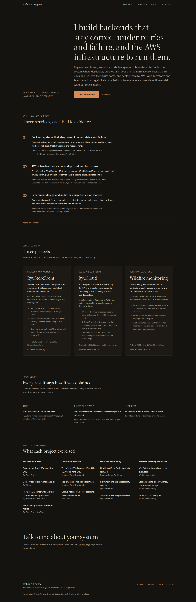
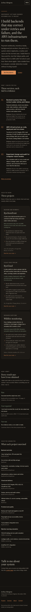

# Review gallery

Screenshots are Chromium via Playwright 1.65.1, taken from the production build by `scripts/e2e.sh`. **Owner sign-off: not done.** Phase 3 pages other than the homepage are placeholders and are not reviewed here.

## Phase 3: homepage and shared layout (2026-11-17)

| Width | Full page |
| --- | --- |
| Desktop 1440 px |  |
| Tablet 820 px |  |
| Phone 390 px |  |

Phone, by section (readable scale): [hero](screenshots/phase3/home-phone-hero.png), [services](screenshots/phase3/home-phone-services.png), [projects](screenshots/phase3/home-phone-projects.png), [verify](screenshots/phase3/home-phone-verify.png), [capabilities](screenshots/phase3/home-phone-capabilities.png).

### Defects found by looking at the screenshots (not by the automated tests), and fixed

1. Section headings rendered at body size: the CSS selector targeted a direct child, but the heading sits inside `.section-head`.
2. Project cards had unequal heights on desktop.
3. Evidence lists had no bullet markers (Tailwind's reset removed them).
4. At 820 px the three cards were squeezed into narrow columns and "Wildfire monitoring" wrapped badly; three columns now start at 1024 px, so tablet stacks them.

### Defect found by the automated checks, and fixed

Links inside running text had no underline (Tailwind's reset removes it), so they were distinguishable by colour only (axe `link-in-text-block`, 3 pages). Links are underlined globally now.

### Look at these (judgement calls for the owner)

- The hero headline is long (four lines on desktop). Shorter is possible but would lose "retries and failure".
- Section headings are modest in size by design; say if you want a larger editorial scale.
- Cards are the only boxed elements. Services and capabilities are ruled lists on purpose.
- The accent is used for the hero rule, primary button, numerals and card hover. Sage is used only for status lines and the verification terms.
- The mobile menu is a native `
` panel labelled "Menu".

### Not checked

Real devices; Firefox and WebKit; a screen-reader walkthrough; forced-colors mode; 200 percent zoom (only 320 to 1440 px layouts were captured); Lighthouse; the mobile menu's visual appearance (its behaviour is tested, and `home-phone-menu-open.png` is not meaningful because the menu was closed at capture time); external links (none exist yet); every non-home page (placeholders).
