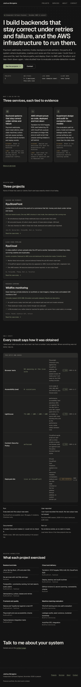

# Review gallery

> **Owner sign-off, 2026-11-18:** the owner signed off on all pages (stated in the session while the contact, education and repository-link edits were being made; user-reported). Sign-off does not close the open items listed in each section's "Look at these" and "Not checked", for example the unexplained mobile performance variance, which the owner chose to leave open.

Screenshots are Chromium via Playwright 1.65.1, taken from the production build by `scripts/e2e.sh`. **Owner sign-off: given 2026-11-18 (all pages).** Everything on the site is now built; Phase 6 is the full responsive, accessibility and performance pass.

## Phase 3: homepage and shared layout (2026-11-17)

| Width | Full page |
| --- | --- |
| Desktop 1440 px |  |
| Tablet 820 px |  |
| Phone 390 px |  |

Phone, by section (readable scale): [hero](screenshots/phase3/home-phone-hero.png), [services](screenshots/phase3/home-phone-services.png), [projects](screenshots/phase3/home-phone-projects.png), [verify](screenshots/phase3/home-phone-verify.png), [capabilities](screenshots/phase3/home-phone-capabilities.png).

### Defects found by looking at the screenshots (not by the automated tests), and fixed

1. Section headings rendered at body size: the CSS selector targeted a direct child, but the heading sits inside `.section-head`.
2. Project cards had unequal heights on desktop.
3. Evidence lists had no bullet markers (Tailwind's reset removed them).
4. At 820 px the three cards were squeezed into narrow columns and "Wildfire monitoring" wrapped badly; three columns now start at 1024 px, so tablet stacks them.

### Defect found by the automated checks, and fixed

Links inside running text had no underline (Tailwind's reset removes it), so they were distinguishable by colour only (axe `link-in-text-block`, 3 pages). Links are underlined globally now.

### Look at these (judgement calls for the owner)

- The hero headline is long (four lines on desktop). Shorter is possible but would lose "retries and failure".
- Section headings are modest in size by design; say if you want a larger editorial scale.
- Cards are the only boxed elements. Services and capabilities are ruled lists on purpose.
- The accent is used for the hero rule, primary button, numerals and card hover. Sage is used only for status lines and the verification terms.
- The mobile menu is a native `
` panel labelled "Menu".

### Not checked

Real devices; Firefox and WebKit; a screen-reader walkthrough; forced-colors mode; 200 percent zoom (only 320 to 1440 px layouts were captured); Lighthouse; the mobile menu's visual appearance (its behaviour is tested, and `home-phone-menu-open.png` is not meaningful because the menu was closed at capture time); external links (none exist yet); every non-home page (placeholders).

## Phase 4: case studies and the projects index (2026-11-17)

Full pages are 10,000 to 15,000 px tall, so each element was also captured on its own (`screenshots/phase4/crops/`, 48 files) so it could be read at normal size.

| Page | Desktop | Tablet | Phone |
| --- | --- | --- | --- |
| Projects index | [full](screenshots/phase4/projects-desktop.png) | [full](screenshots/phase4/projects-tablet.png) | [full](screenshots/phase4/projects-phone.png) |
| RyuStoreFront | [full](screenshots/phase4/projects-ryustorefront-desktop.png) | [full](screenshots/phase4/projects-ryustorefront-tablet.png) | [full](screenshots/phase4/projects-ryustorefront-phone.png) |
| Wildfire monitoring | [full](screenshots/phase4/projects-wildfire-monitoring-desktop.png) | [full](screenshots/phase4/projects-wildfire-monitoring-tablet.png) | [full](screenshots/phase4/projects-wildfire-monitoring-phone.png) |
| RyuCloud | [full](screenshots/phase4/projects-ryucloud-desktop.png) | [full](screenshots/phase4/projects-ryucloud-tablet.png) | [full](screenshots/phase4/projects-ryucloud-phone.png) |

Diagrams (desktop): [StoreFront architecture](screenshots/phase4/crops/ryustorefront-desktop-diagram1.png), [order state machine](screenshots/phase4/crops/ryustorefront-desktop-diagram2.png), [RyuCloud architecture](screenshots/phase4/crops/ryucloud-desktop-diagram1.png), [crash recovery](screenshots/phase4/crops/ryucloud-desktop-diagram2.png), [wildfire architecture](screenshots/phase4/crops/wildfire-monitoring-desktop-diagram1.png).
Figures: [Level 2 matrix on its mat](screenshots/phase4/crops/wildfire-monitoring-desktop-figure1.png), [StoreFront listing capture](screenshots/phase4/crops/ryustorefront-desktop-figure1.png). Phone: [header](screenshots/phase4/crops/wildfire-monitoring-phone-header.png), [numeric table](screenshots/phase4/crops/wildfire-monitoring-phone-table3.png), [diagram](screenshots/phase4/crops/ryucloud-phone-diagram1.png).

### Defects found by the automated checks, and fixed

1. Wide tables that scroll sideways on a phone were not keyboard-focusable (axe `scrollable-region-focusable`). Every table is now a named, focusable region.
2. The same defect on the RyuCloud code block (found only after the first fix). Now a named, focusable region.
3. The test run also exposed type errors in my own test code; fixed so `astro check` is clean.

### Defects found by looking at screenshots (the tests could not see these), and fixed

1. Wildfire diagram: "telemetry" touched a box edge and "pose out, image back" sat on top of its arrow. Gap widened and labels moved.
2. RyuCloud crash timeline (the worst one): labels sat on lane lines, the footer text overlapped a box, and an arrow crossed another box. Redrawn with no crossings.
3. RyuCloud architecture: "claim with a lease" was clipped at the right edge, and "playback" sat on the dashed upload line.
4. StoreFront architecture: "signed webhook" collided with its arrow and "claims events" sat on a line.
5. Labels now carry a thin background-coloured halo so a line passing behind them cannot make them unreadable.
6. Phone: numbers in the wildfire tables wrapped inside narrow columns ("177.1 plus or minus 7.0" split over lines). Numeric tables now keep their columns and scroll, with a visible hint and a caption that stays in place.
7. Phone: the "Built" and "Not built" tables crammed long lists into two narrow columns. They are now two stacked blocks on a phone.
8. Prose lists had no bullets or numbers (the CSS reset removed them). Restored, with accent-coloured markers.
9. Phone: the long status line was too large. Smaller below 768 px.
10. Diagrams that scroll sideways on a phone had no cue. A hint now appears below 768 px.

### Look at these (judgement calls for the owner)

- **Length.** The case studies are long (about 10,000 to 15,000 px). They follow the 8-section template, but collapsing "Evidence" into expandable groups is possible if you want shorter pages. I did not, so nothing is hidden by default.
- **Light mats.** The six wildfire figures were drawn on white, in blue and orange, which fight the warm dark palette. I framed them on a light mat (`--color-plate`) with a "Report figure" label rather than alter your charts. Redrawing them in the site palette is possible from the recorded numbers.
- **Screenshot honesty.** Every StoreFront image is labelled "Real API data" or "Fixture data". The "real" listing shows 100 products, not the 49,507 in older notes.
- **Status wording.** "Documented" is a fourth label next to Run, User-reported and Not run. It is used for the wildfire results, which I quote but did not re-run.
- **Phone diagrams.** They scroll sideways rather than reflow. Redrawing a vertical phone layout for each is possible if you prefer.

### Not checked

Real devices; Firefox and WebKit; a screen-reader walkthrough; forced-colors mode; 200 percent zoom; Lighthouse; whether the cross-document page transition behaves; the Services, About and Contact pages (placeholders); external links (none exist).

## Phase 5: services, about, contact (2026-11-17)

| Page | Desktop | Tablet | Phone |
| --- | --- | --- | --- |
| Services | [full](screenshots/phase5/services-desktop.png) | [full](screenshots/phase5/services-tablet.png) | [full](screenshots/phase5/services-phone.png) |
| About | [full](screenshots/phase5/about-desktop.png) | [full](screenshots/phase5/about-tablet.png) | [full](screenshots/phase5/about-phone.png) |
| Contact | [full](screenshots/phase5/contact-desktop.png) | [full](screenshots/phase5/contact-tablet.png) | [full](screenshots/phase5/contact-phone.png) |

### Defects found, and fixed

1. **Services was 7,693 px tall** because it repeated the full evidence blocks that the case studies already contain. Evidence lines are now the one-line form with status and date, and a pointer to the case study for setup and caveats (5,981 px).
2. **The contact intro said "details are being added" even once details were supplied.** Found by temporarily filling the contact data with fake values and building; now conditional.
3. Wording I softened before it went live: a personality claim ("likes the parts where things go wrong") that you had not given me, an attribution of every audit to the AI reviewer (the evidence names it for the split-leakage audit only), and a promise on your behalf about who runs AWS commands.

### Look at these (judgement calls for the owner)

- The **How I work** text is a draft from the evidence plus your answers. Please confirm each line, especially the GPU-budget sentence: the wildfire notes call the budget "autonomous", and I did not claim who launched the jobs.
- The **contact page is narrow and centred** on purpose (one reading column); the other pages use the full width.
- **Services is still long** (about 6,000 px at desktop). The three services each have what, how, evidence and limits.
- **Contact and resume are placeholders** ("To be added."). See the README for the one place to fill them in.

### Not checked

Real devices; Firefox and WebKit; a screen-reader walkthrough; forced-colors mode; 200 percent zoom; Lighthouse.

## Phase 6: responsive, accessibility and performance (2026-11-17)

Captures are in `screenshots/phase6/`: [forced colors, home](screenshots/phase6/forced-colors-home.png), [forced colors, RyuCloud](screenshots/phase6/forced-colors-ryucloud.png), 320 px first screens ([home](screenshots/phase6/w320-home.png), [StoreFront](screenshots/phase6/w320-ryustorefront.png), [wildfire](screenshots/phase6/w320-wildfire-monitoring.png), [services](screenshots/phase6/w320-services.png)), the [320 px menu](screenshots/phase6/w320-menu-open.png) and a [200% zoom view](screenshots/phase6/zoom200-wildfire.png). Lighthouse and page-weight numbers are in `docs/verification.md`; raw summaries are in `lighthouse/`.

### Defects found, and fixed

1. **Case-study descriptions were too long for search results** (186, 216 and 179 characters). Shortened to 160 or fewer.
2. **In forced-colors (high-contrast) mode the primary button lost its background and looked like plain text.** The button and the skip link now have a transparent border, which the browser draws in forced-colors mode.
3. The first run also exposed four test mistakes of mine (listed in `docs/verification.md`).

### Experiment that I reverted

Inlining the stylesheet (`inlineStylesheets: 'always'`) removed Lighthouse's "render-blocking" insight and cut mobile LCP on the small pages from about 920 ms to about 627 ms. But the three case studies got slightly slower (15 to 60 ms), the performance score dropped from 100 to 99 on several pages, and every page would re-ship its own CSS instead of sharing one cached file on a CDN. I kept the default. Both data sets are in `lighthouse/`.

### Look at these (judgement calls for the owner)

- **Scores are a local best case.** 17 of 18 runs scored 100; one scored 99. That is a small static site on a local server with no network cost. The honest figure to quote after deployment is the Phase 7 run against CloudFront.
- **Fonts are 80 percent of the home page's bytes** (144 of 180 KB). Dropping a face or subsetting would shrink it, but Source Serif's reserved font name forbids subsetting without renaming (see `docs/fonts.md`).
- **The long pages stay fully open**, as you asked.

### Not checked

Real devices; Firefox and WebKit; a screen-reader walkthrough; an HTML validator; Lighthouse on the deployed site; behaviour under a real CDN with compression.

## Phase 7: deployment preparation (2026-11-17)

Mostly not visual. The new page is the 404: [desktop](screenshots/phase7/404-desktop.png), [phone](screenshots/phase7/404-phone.png). It matches the rest of the site (one heading, five links, 44 px targets) and is not indexable.

### Defects found, and fixed

1. **A stray `.gitkeep` and an unmapped `.md` file in the build** would have made the upload script refuse to deploy. Removed the placeholder; mapped the font licence text (the OFL requires it to ship with the fonts).
2. **Inline style attributes** on four figures meant the CSP could not forbid inline styles. Replaced by CSS classes.
3. **Inline scripts** meant the CSP could not forbid inline scripts. Moved into one external file.

### Look at these (judgement calls for the owner)

- **The strict CSP costs about 160 ms of mobile LCP on Lighthouse's simulated slow 4G** (median 762 ms before, about 922 ms after; desktop 211 to about 281 ms). Scores are unaffected. If you would rather have the speed, the menu's Escape handling and the card spotlight are the only things the script does; dropping them allows `script-src 'none'`. See D12 and `design/lighthouse/`.
- **No Open Graph image.** Shared links will show a title and description only.
- **The default CloudFront address cannot enforce TLS 1.2 or later**; a custom domain can.

### Not checked

Everything that needs a real deployment: `terraform plan` and `apply`, the CloudFront Function in CloudFront's runtime, headers, compression and caching on a real distribution, cost, and Lighthouse against the live site. No security scanner was run on the Terraform.

## Redesign: editorial to developer tooling (2026-11-17)

You said the site looked like a site for books. It did: serif headlines, cream-on-brown, a copper accent. The redesign changes the type, the palette and the homepage; the content and the evidence rules are unchanged. Updated captures (same paths as before): [home, desktop](screenshots/phase3/home-desktop.png), [home, phone hero](screenshots/phase3/home-phone-hero.png), [home, verify section on a phone](screenshots/phase3/home-phone-verify.png), [StoreFront diagram](screenshots/phase4/crops/ryustorefront-desktop-diagram1.png), [RyuCloud diagram](screenshots/phase4/crops/ryucloud-desktop-diagram1.png), [RyuCloud header](screenshots/phase4/crops/ryucloud-desktop-header.png).

What changed: Geist Sans and Geist Mono replace the serif and sans pairing; your palette (sage primary, amber secondary, no blue tint) replaces copper; the homepage has a status chip, a large headline, a sage primary button, a spec strip of true facts, icon-led service cards, restyled project cards, and a panel of this site's own recorded checks; status badges have Lucide icons; the diagrams have an amber dashed flow on key request paths (static under reduced motion).

### Defects found, and fixed

1. The "signed webhook" label collided with the animated dashed line. Moved below the arrow.
2. The Lighthouse result wrapped onto two lines in the checks panel. Column widened, text kept on one line.

### Look at these (judgement calls for the owner)

- **Mobile performance is worse after the redesign and I do not know why.** Scores went from 99 to 100 to a range of 90 to 100 on mobile (desktop is still 100). The VM was visibly slower during these runs, so it may be the machine, but I could not prove it. Decision D13 and `docs/verification.md` have the numbers. A fresh run on a quiet machine will settle it.
- **I did not use Next.js, shadcn/ui or Motion** from your brief; the reasons are in `design/COMPONENT-NOTES.md`. Say so if you want any of them.
- **The "own checks" panel is hand-maintained.** Its numbers are right for today and will go stale if the checks are rerun without updating `src/data/checks.ts`.
- **Amber is used sparingly** (motion, "User-reported", small labels). Say if you want more or less of it.
- **Pages I did not re-inspect after the redesign:** Services, About, Contact and the 404 render with the new tokens and pass every automated check, but I only looked at the home page and the case-study diagrams and header.

### Not checked

Real devices; Firefox and WebKit; a screen-reader walkthrough; the deployed site.

## Background texture (2026-11-18)

Requested by the owner. Full-resolution captures: [hero, desktop](screenshots/phase8/hero-texture-desktop.png), [hero, phone](screenshots/phase8/hero-texture-phone.png), [the checks panel after its layout fix](screenshots/phase8/checks-panel-desktop.png).

### Defects found, and fixed

1. My first grain lightened the whole page from `#141414` to about `#1c1c1c`, so the palette on screen was not the palette specified. A pixel-measuring test caught a second version still at 25.5 (linear colour space in SVG filters); now 20.2.
2. The first dots were barely visible; strengthened.
3. Longer result strings in the home page's checks panel overlapped the description column; fixed.

### Look at these (judgement calls for the owner)

- **Strength.** The grain is visible but restrained (specks within about 8 levels of the background). Raise or lower `--texture-grain` and `--dot-color` in `src/styles/tokens.css`.
- **Where.** Dots appear on the home hero only. Say if you want them on page headers too.
- **Phone.** The dots look larger and more prominent on a phone because the pattern does not scale with the screen.

### Not checked

Real devices; Firefox and WebKit (mix-blend-mode and masks are supported but untested here); the texture on the live site until you upload.
